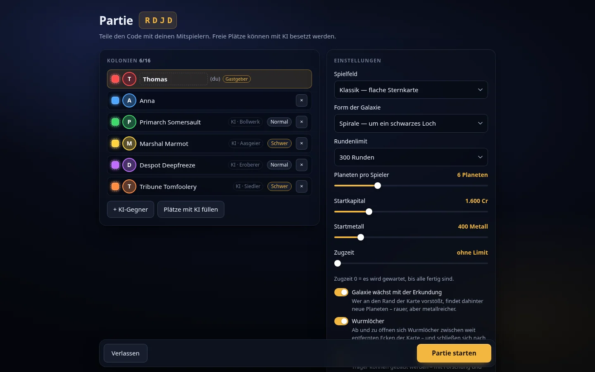
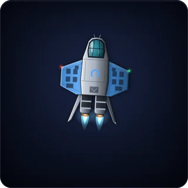
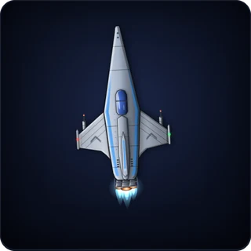
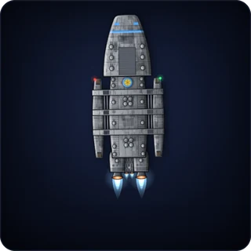
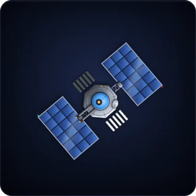
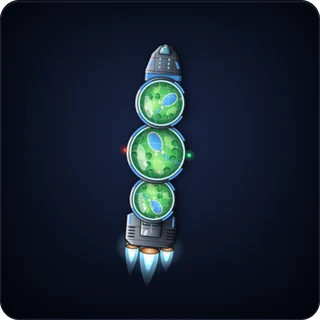
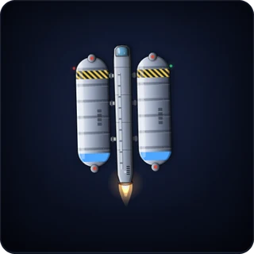
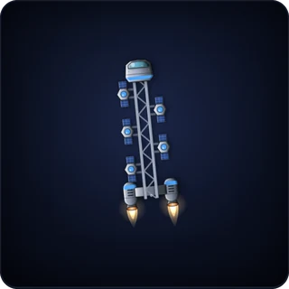
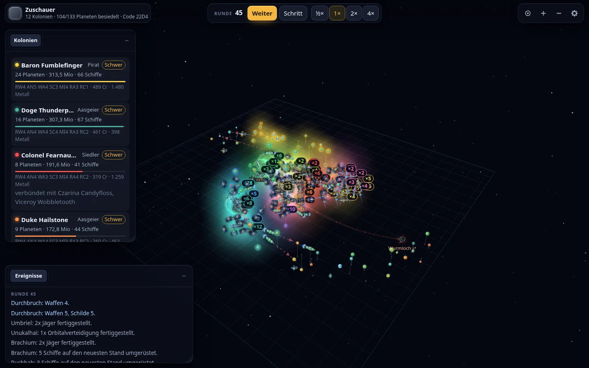
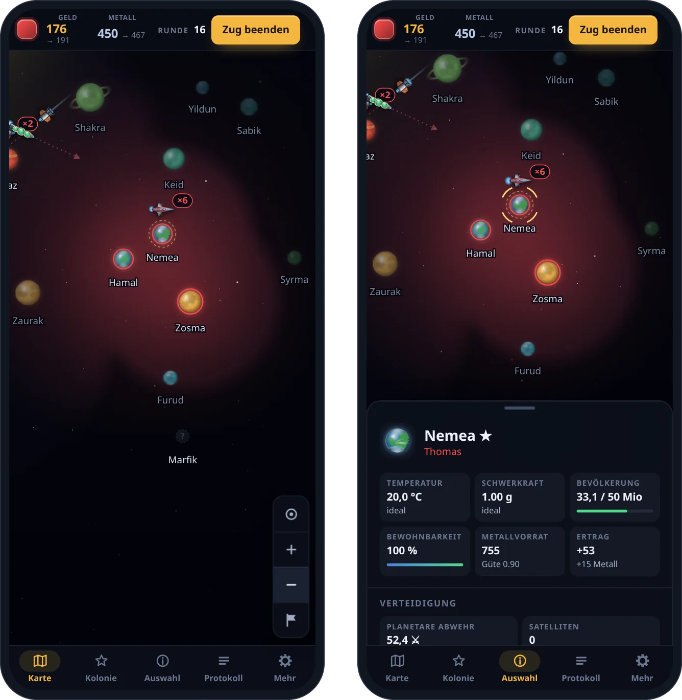

# Spielen

*[English](playing.md) · **Deutsch*** · [← Übersicht](../readme.de.md)

- [Eine Partie beginnen](#eine-partie-beginnen)
- [Spielprinzip](#spielprinzip)
- [Die Schiffstypen](#die-schiffstypen)
- [Geld, Metall und der Haushalt](#geld-metall-und-der-haushalt)
- [Kampf und Eroberung](#kampf-und-eroberung)
- [Bündnisse](#bündnisse)
- [Form der Galaxie: Streufeld oder Spirale](#form-der-galaxie-streufeld-oder-spirale)
- [Zwei Spielfelder: Klassik und Raum](#zwei-spielfelder-klassik-und-raum)
- [Eine Galaxie ohne Rand](#eine-galaxie-ohne-rand)
- [Wurmlöcher](#wurmlöcher)
- [Aliens](#aliens)
- [Die KI-Kolonien](#die-ki-kolonien)
- [Zusehen](#zusehen)
- [Rangliste und Sieg](#rangliste-und-sieg)
- [Steuerung](#steuerung)
- [Auf Telefon und Tablet](#auf-telefon-und-tablet)
- [Die Optik](#die-optik)

## Eine Partie beginnen

- **Schnell:** *Sofort gegen 5 KI spielen* – Partie anlegen, auffüllen, los.
- **Mit Freunden:** *Neue Partie eröffnen*, den vierstelligen Code weitergeben,
  freie Plätze mit KI füllen, starten. Im LAN erreichen die anderen den Server
  unter `http://<deine-ip>:8080`.
- **Zuschauen:** *Beim Spielen zusehen* startet eine reine KI-Partie, die von
  allein läuft (siehe [Zusehen](#zusehen)).

**Profil.** Im Startbildschirm stehen dein Anzeigename und dein Bild. Klick auf
den Kreis neben dem Namen lädt ein Bild hoch; es wird im Browser quadratisch
zugeschnitten und verkleinert. Mit Konto gehören Name und Bild zum Konto und
gelten auf jedem Gerät, ohne Konto merkt sie sich der Browser. Der Name ist frei
wählbar, darf aber nicht wie ein *anderes* Konto heißen; in einer Partie heißt
jeder anders (notfalls mit Nummer), und weicht der Name vom Konto ab, steht der
Kontoname klein daneben. In der Lobby lassen sich Name und Bild in der eigenen
Zeile ändern.

**Farben.** Ein Klick auf das eigene Farbfeld öffnet die Palette. Jede Farbe gibt
es einmal; vergebene haben eine abgeschnittene Ecke. Die Farbe eines Mitspielers
nimmt nur der Host – dann tauschen beide. Der Host färbt auch die KI-Kolonien.

**Einstellungen** legt der Host fest; alle anderen sehen sie als reine Anzeige
mit dem Hinweis, wer sie ändern kann:

| Einstellung | Bedeutung |
|---|---|
| Spielfeld | *Klassik* (flach) oder *Raum* (dreidimensional) |
| Form der Galaxie | *Streufeld* oder *Spirale* mit schwarzem Loch |
| Rundenlimit | 100, 200, 300, 500, unbegrenzt oder *Schnelles Spiel* mit einer eigenen Zahl von 20 bis 99 |
| Planeten pro Spieler | 3–14 |
| Startkapital, Startmetall | Kasse zu Beginn |
| Zugzeit | 0 = es wird gewartet, bis alle fertig sind |
| Galaxie wächst | siehe [Eine Galaxie ohne Rand](#eine-galaxie-ohne-rand); aus ergibt eine feste Karte |
| Wurmlöcher | siehe [Wurmlöcher](#wurmlöcher) |
| Großkampfschiffe | Träger sind baubar (siehe [Die Schiffstypen](#die-schiffstypen)); aus ergibt ein klassisches Ho!! nur mit den kleinen Schiffen |
| Bündnisse | Kolonien können sich verbünden (siehe [Bündnisse](#bündnisse)); aus ergibt ein Jeder gegen jeden |

**Verbindung.** Ein getrennter Spieler blockiert die Runde nicht – er wird
übersprungen und kann jederzeit zurückkehren (der Platz wird im Browser
gespeichert). Mit Anmeldung lässt sich eine Partie auch auf einem anderen Gerät
fortsetzen: Das Startmenü zeigt sie unter *Deine Partien auf einem anderen
Gerät*, *Hier weiterspielen* holt den Platz herüber, und das erste Gerät kehrt
ins Startmenü zurück. Die anderen Spieler merken davon nichts. Wer über *Verlassen* aussteigt, gibt den Platz endgültig auf: die
Kolonie bleibt stehen und wird übersprungen. Partien ohne verbundene Spieler werden
nach zwei Stunden aufgeräumt.

## Spielprinzip

Alle ziehen **gleichzeitig**. Jeder erteilt seine Befehle und klickt
*Zug beenden*; sobald alle fertig sind (oder die Zugzeit abläuft), rechnet der
Server die Runde ab – Forschung, Bau, Umrüstung, Terraforming, Bewegung, Kampf,
Kolonisierung, Wirtschaft.

| Begriff | Bedeutung |
|---|---|
| **Ideal** | 20 °C und 1,0 g. Je näher ein Planet daran liegt, desto mehr Menschen leben dort und desto mehr Geld bringt er. |
| **Terraforming** | Kostet jede Runde das eingestellte Budget und schiebt Temperatur und Schwerkraft Richtung Ideal. Extreme Planeten brauchen erst höhere **Radikaltechnik**. |
| **Metall** | Wird auf den eigenen Planeten gefördert, in einen gemeinsamen Vorrat gelegt und beim Schiffsbau verbraucht. Der Vorrat eines Planeten erschöpft sich; danach liefert er im Tiefbau noch ein Zehntel. |
| **Reichweite** | Abstand vom nächsten *bewohnten eigenen* Planeten – oder dem eines Verbündeten. Neu besiedelte Planeten sind damit Sprungbretter; Tanker erweitern den Radius. |
| **Technikstand** | Schiffe werden mit dem Stand ihres Baujahrs gebaut und behalten ihn. Höhere Stufen machen Schiffe besser *und teurer* – **Miniaturisierung** senkt die Kosten wieder. Veraltete Schiffe lassen sich in einer Werft **umrüsten**. |
| **Abwehrbatterie** | Jeder bewohnte Planet verteidigt sich selbst, proportional zur Bevölkerung. |
| **Orbitalverteidigung** | Billige Satelliten, die im Orbit bleiben. Selbst fliegen können sie nicht, aber ein **Transporter** bringt bis zu fünf davon zu einem anderen eigenen Planeten. Ab fünf Stück spannen sie einen Schild auf. |
| **Recycling** | Ein eigenes Forschungsfeld. Ab Stufe 2 lassen sich Schiffe und Satelliten an einer eigenen Werft sofort wieder zerlegen: Das kostet Geld und bringt einen Teil des Metalls ihres Baupreises zurück. Stufe 2 gibt 25 % des Metalls für 50 % des Geldes; jede Stufe verbessert das, bis Stufe 16 die Grenze erreicht – 80 % des Metalls für 5 % des Geldes. Eine Flotte geht als Ganzes (vorher teilen), Satelliten nach Stückzahl, die ältesten zuerst. |

## Die Schiffstypen

Sieben Klassen, jede mit eigener Aufgabe. Gebaut wird in der Werft eines eigenen
Planeten; ein Klick auf ein Schiff dort – oder *Schiffstypen ansehen* in der Spielanleitung
(`H`) – öffnet den Steckbrief mit den aktuellen Werten.

| | |
|---|---|
|  | **Späher** – der schnellste Typ mit großer Reichweite. Erst ein Späher deckt Temperatur, Schwerkraft und Metallvorrat eines Planeten auf. Waffenlos und zerbrechlich: feindlichen Flotten lieber ausweichen. |
|  | **Jäger** – das Rückgrat jeder Flotte, mit Waffen und Schilden. Wer den Orbit hält und Abwehrbatterie und Orbitalverteidigung bricht, erobert den Planeten. Kurze Reichweite – für Angriffe tief im Feindgebiet einen Tanker mitschicken. |
|  | **Träger** – das Großkampfschiff und der Anker einer Flotte. Kostet so viel wie zehn Jäger und kämpft etwa so gut wie sie, aber auf eigene Art: Acht Geschütze feuern jede Runde auf verschiedene Ziele, und der Rumpf zieht das Feuer auf sich wie vier Jäger. Im Orbit eines eigenen Planeten repariert er seine ganze Flotte, 20 % jeder Hülle pro Runde ohne Kampf dort. Gegen Planeten schwach – Erobern bleibt Sache der Jäger. Braucht Waffen 5 und Schilde 5 und eine Werft auf einem Planeten ab 20 Mio. Einwohnern. Jeder Träger führt einen historischen Schiffsnamen, den du im Flottenpanel ändern kannst. |
|  | **Orbitalverteidigung** – ein Satellit, der direkt im Orbit des Bauplaneten entsteht und dort bleibt. Billig, zäh und kräftig bewaffnet; ab fünf Stück spannen sie einen Schild auf. Ein Planet mit Satelliten fällt nicht kampflos. |
|  | **Kolonieschiff** – setzt 8 Mio. Siedler auf einem freien Planeten ab und geht dabei auf. Über einem eigenen, noch nicht vollen Planeten stockt *Siedler hier absetzen* die Bevölkerung auf. Langsam und wehrlos – Geleitschutz lohnt sich. |
|  | **Tanker** – kämpft nicht, gibt aber der ganzen Flotte seine Reichweite, mehr als doppelt so viel wie ein Jäger. Jeder weitere Tanker in derselben Flotte bringt +15 %. |
|  | **Transporter** – nimmt im Orbit eines eigenen Planeten bis zu fünf Satelliten an Bord und setzt sie über einem anderen eigenen Planeten wieder aus; so wandert die Verteidigung dorthin, wo Gefahr droht. Geladene Satelliten kämpfen nicht und gehen mit dem Transporter verloren. Verlängert die Reichweite der Flotte nicht. |

Die Grundwerte bei Technikstufe 1 – Forschung verbessert sie, Neubauten bekommen
den jeweils aktuellen Stand:

| Typ | Kosten | Angriff | Hülle | Tempo | Reichweite |
|---|---|---|---|---|---|
| Späher | 8 Cr · 3 Metall | – | 10 | 71 Lj/R | 323 Lj |
| Jäger | 14 Cr · 7 Metall | 5 | 22 | 42 Lj/R | 170 Lj |
| Träger | 140 Cr · 80 Metall | 8 × 5 | 320 | 29 Lj/R | 170 Lj |
| Orbitalverteidigung | 10 Cr · 5 Metall | 6 | 34 | – | – |
| Kolonieschiff | 30 Cr · 12 Metall | – | 16 | 34 Lj/R | 221 Lj |
| Tanker | 18 Cr · 6 Metall | – | 20 | 38 Lj/R | 442 Lj |
| Transporter | 20 Cr · 8 Metall | – | 26 | 38 Lj/R | 442 Lj |

Eine Flotte fliegt so schnell wie ihr langsamstes Schiff und so weit wie ihr
bestes (plus Tanker). Jedes Schiff hat die Farbe seiner Kolonie – beim Jäger etwa
die Streifen am Rumpf.

## Geld, Metall und der Haushalt

Abgebucht wird am Rundenende in fester Reihenfolge: **Forschung, Schiffsbau,
Umrüstung, Terraforming** – die **Einnahmen kommen zuletzt** und bezahlen erst
die nächste Runde. Fürs Bauen steht also *Geld minus Forschungsanteil* bereit,
und zwar für alle Werften zusammen. Ein Durchbruch in derselben Runde macht
Schiffe teurer, weil sie mit dem neuen Stand gebaut werden.

Damit das niemand im Kopf rechnen muss:

- Die Kopfleiste zeigt **jetzt → nächste Runde**, etwa `Geld 1.600 → 811`.
- Ein Klick (oder der Mauszeiger) auf Geld oder Metall öffnet den **Haushalt**:
  Bestand, jeder Posten in Abbuchungsreihenfolge, Einnahmen und Förderung,
  darunter das Ergebnis. Die Vorschau rechnet mit genau den Regeln des Servers;
  nur Kämpfe und Eroberungen in derselben Runde können die Einnahmen noch ändern.
- **Angenommen wird nur, was bezahlbar ist.** Reicht es nicht mehr, ist `+` in
  der Werft gesperrt, und der Server lehnt den Auftrag mit einem Hinweis ab.
  Zieht man danach den Forschungsanteil hoch, bleibt er beim höchsten Wert
  stehen, bei dem die Aufträge noch aufgehen – **Aufträge gehen vor**. Ein Bau,
  der am Rundenende am Geld scheitert, kommt dadurch nicht vor.

## Kampf und Eroberung

Treffen in einem Orbit feindliche Flotten aufeinander, wird gekämpft – vorn
steht, wer austeilt, dahinter, wer beschützt wird. Wer abfliegt, während ein
bewaffneter Gegner im Orbit steht, wird **abgefangen** und muss noch drei
Gefechtsrunden überstehen. Jede Schlacht lässt sich nachträglich ansehen: ein
Klick auf die Meldung öffnet die Aufzeichnung.

**Abfangen im Flug:** Eine bewaffnete Flotte kann eine fremde Flotte verfolgen,
die sie im Flug sieht – Rechtsklick darauf bei gewählter eigener Flotte, oder
*Abfangen* in deren Panel. Jede Runde hält deine Flotte auf den Punkt zu, an dem
sie das Ziel auf seinem Kurs trifft. Kommen sie sich nah genug, halten beide an
und kämpfen im freien Raum, ohne Abwehrbatterie und Satelliten; wer überlebt,
fliegt danach weiter. Eine schnellere Flotte holt ein, eine langsamere nur im
Gegenkurs. Erreicht das Ziel einen Orbit, folgt deine Flotte dorthin; gerät es
außer Sicht, endet die Verfolgung. Auch die KI-Kolonien fangen ab. Abschaltbar
in der Lobby.

Ein Planet fällt, wenn ein Angreifer den Orbit hält und weder
Orbitalverteidigung noch Abwehrbatterie überlebt haben. Die Bevölkerung geht
dabei zurück, der Rest wechselt den Besitzer.

Schaden bleibt am Schiff. Reparieren kann nur ein **Träger**: Im Orbit eines
eigenen Planeten bekommt seine ganze Flotte in jeder Runde ohne Kampf dort 20 % jeder
Hülle zurück. Seine acht Geschütze suchen sich jeweils ein eigenes Ziel, und er
zieht das Feuer auf sich wie vier Jäger – die kleinen Schiffe seiner Flotte
werden seltener getroffen.

## Bündnisse

In der Rangliste (linkes Fenster, Reiter *Rangliste*) bietest du jeder Kolonie ein
Bündnis an – **offen**, sodass alle davon erfahren, oder **geheim**. Die andere
Seite nimmt an oder lehnt ab; ein Angebot gilt fünf Runden, und nach einer
Ablehnung musst du zehn Runden warten, bevor du dieselbe Kolonie wieder fragst.

Ein Bündnis verbindet immer zwei Kolonien:

- **Frieden:** Verbündete greifen sich nicht an – weder ihre Flotten noch die
  Abwehr ihrer Planeten. Flotten dürfen den Orbit eines Verbündeten besuchen und
  dort bleiben.
- **Seite an Seite:** Wird ein Verbündeter angegriffen, kämpfen seine Flotten im
  Orbit mit. Ein Kolonieschiff darf unter dem Geleitschutz eines Verbündeten
  landen.
- **Gemeinsame Sicht:** Du siehst, was dein Verbündeter sieht – seine Planeten und
  Flotten sind auch deine Augen.
- **Versorgung:** Die bewohnten Planeten eines Verbündeten versorgen deine Flotten
  wie eigene, deine Schiffe reichen also weiter.

Bündnisse werden nicht weitergegeben: Ist A mit B und B mit C verbündet, kämpfen
A und C trotzdem gegeneinander.

**Geheimbündnisse** kennen nur die beiden Partner – bis jemand Flotten beider
friedlich im selben Orbit sieht, oder die Flotte des einen über einem Planeten des
anderen. Dieser Beobachter weiß es dann, und das Log sagt ihm, wo. Jeder Partner
kann ein Geheimbündnis jederzeit **öffentlich** machen, etwa um einen Angreifer
abzuschrecken.

**Kündigen** geht jederzeit. Das Bündnis gilt dann noch zwei Runden; danach
kämpfen Flotten, die noch im Orbit des früheren Partners stehen. Behalte Gäste in
deinem eigenen Orbit im Auge.

Bleiben nur Verbündete übrig und hat niemand gekündigt, gewinnen sie
**gemeinsam**. Auch die KI-Kolonien schließen Bündnisse (siehe
[Die KI-Kolonien](#die-ki-kolonien)), und der Gastgeber kann Bündnisse in der Lobby
abschalten.

## Form der Galaxie: Streufeld oder Spirale

*Streufeld* verteilt die Planeten gleichmäßig. *Spirale* baut eine Galaxie, wie man
sie sich vorstellt: zwei oder drei logarithmische Arme um einen dichten Kern, und
in der Mitte ein **schwarzes Loch** mit Namen wie *Charybdis* oder *Nyx*.

Das Loch ist Gelände, kein Hintergrund. Um den Schlund liegt eine **Sperrzone**
(gestrichelter Ring): dort entsteht kein Planet, und keine Flotte fliegt hinein.
Wer ein Ziel dahinter anfliegt, wird **automatisch außen herum** geführt. Der Weg
wird länger und kostet Runden; auch die **Reichweite** misst den fliegbaren Weg,
nicht die Luftlinie – Planeten hinter dem Loch liegen spielerisch weiter weg, als sie
aussehen. Der Reichweiten-Umriss auf der Karte hat deshalb zum Loch hin eine Delle,
und *Flotte hierher* ist für unerreichbare Planeten von vornherein gesperrt.

Eine Spirale wächst nach außen: Stößt jemand an die Armspitzen vor, reichen die
Arme weiter, und neue Planeten entstehen entlang der Arme.

## Zwei Spielfelder: Klassik und Raum

*Klassik* ist die flache Sternkarte. *Raum* verteilt dieselbe Partie auf drei
Dimensionen: die Planeten liegen in einer **Linse**, mittig dicker, zum Rand hin
dünner. Entfernungen, Reichweite und Scanner rechnen dann räumlich.

Drei Lesehilfen halten den Raum lesbar: ein **Gitter** in der Mittelebene, ein
**Lot** von jedem Planeten auf dieses Gitter (daran liest man die Höhe ab) und eine
Abstufung von Größe und Helligkeit nach Entfernung. Steuerung siehe
[Steuerung](#steuerung).

Die Reichweite ist im Raum eine Kugel um jeden bewohnten Planeten – zeichnen lässt sich
das nicht lesbar. Mit dem Schalter *Reichweite* markiert die Raumansicht deshalb die
**Ziele**: Planeten, die die gewählte Flotte erreicht, bekommen einen blauen Schimmer
(violett: nur durch ein Wurmloch), alle anderen treten zurück. Fährt die Maus über
einen Planeten, zeigt eine Linie den Weg der Versorgung vom nächsten eigenen Planeten,
beschriftet mit *nötig / Reichweite* – rot, wenn es zu weit ist.

## Eine Galaxie ohne Rand

Kommt eine Flotte oder ein besiedelter Planet der Grenze näher als 200 Lj, schiebt sich
die Karte dort hinaus und ein neuer Streifen Planeten entsteht – höchstens einer pro
Runde. Je weiter draußen, desto unwirtlicher die Planeten (extremere Temperatur und
Schwerkraft), dafür mit mehr und besserem Metall. Draußen zu siedeln lohnt sich,
kostet aber Terraforming und Radikaltechnik. Mit 16 KI wächst die Karte von 96
auf rund 390 Planeten in 120 Runden. Abschaltbar in der Lobby.

## Wurmlöcher

Ab Runde 12 öffnen sich ab und zu Wurmlöcher: zwei Mündungen weit auseinander –
mindestens die halbe längere Kartenseite –, beide mit Planeten in der Nähe. Eine
Mündung kommt wie ein Planet in Sicht: in Scannerreichweite deiner Planeten und
Flotten. Es ist immer höchstens eines offen.

- **Springen:** Flotte auswählen, dann die Mündung anklicken (oder *Hineinfliegen*
  in ihrem Panel). Die Flotte fliegt hin, springt und steht an der anderen Mündung.
- **Wohin:** Das zeigt erst der erste Sprung. Danach kennst du beide Enden, die
  Karte zeichnet den Tunnel dazwischen, und der Rückweg geht auch. Andere Kolonien
  wissen es weiterhin nicht.
- **Versorgung:** Die Reichweite misst wie immer ab deinen bewohnten Planeten. Ein
  offenes Wurmloch, das du kennst, trägt sie auf seine andere Seite – eine Flotte
  dort fliegt so weit, wie nach dem Weg von daheim bis zum Eingang übrig ist (der
  violette Umriss). Von daheim direkt hinüber, durch unbekannten Raum, gibt es
  keinen Weg.
- **Zusammenbruch:** Ein Wurmloch lebt 16–28 Runden; in den letzten drei flackert
  es rot. Flotten auf dem Weg dorthin bleiben stehen; wer drüben ist, ist
  abgeschnitten – es sei denn, ein Kolonieschiff besiedelt dort einen neuen Planeten.

Wurmlöcher lassen sich in der Lobby abschalten. Die neugierigen KI-Charaktere –
Siedler, Plünderer und Aasgeier – nutzen sie: Erst schaut ein Späher nach, dann
folgen Kolonieschiffe zu freien Planeten oder ein Rudel geht drüben auf Jagd; der
Plünderer springt auch blind. Bevor das Wurmloch zusammenbricht, kehren sie heim.

## Aliens

Gelegentlich erscheinen Aliens: ein **Alien-Träger** und mehrere
**Alien-Jäger**. Sie tauchen in Sichtweite eines Planeten auf, ein paar Flugrunden
entfernt; der Funk nennt das Ziel. Auf der Karte umschwirren die Jäger ihren
Träger als Wolke.

- **Ziel:** die Kolonie mit den bisher wenigsten Alien-Angriffen.
- **Wirkung:** Sie erobern nicht. Ein Planet, dessen Orbit sie allein halten,
  wird entvölkert und frei. Den letzten Planeten einer Kolonie greifen sie nie an.
- **Träger:** Ersetzt pro Runde ohne Kampf verlorene Jäger. Sind alle Träger
  zerstört, ziehen die Jäger ab. Sonst ziehen sie nach einigen Planeten, einigen
  Runden oder schweren Verlusten ab.

Die Stärke stellt der Gastgeber in der Lobby ein (oder schaltet sie ab):

| | Leicht | Mittel | Stark |
|---|---|---|---|
| Erster Angriff | Runde 30 | Runde 25 | Runde 20 |
| Abstand (sechs Kolonien) | etwa 15 Runden | etwa 10 Runden | etwa 6 Runden |
| Besuchte Kolonien | ab 3 Planeten | ab 3 Planeten | ab 2 Planeten |
| Jäger | 3, später bis 9 | 5, später bis 14 | 8, später bis 22 |
| Träger | 1 | 1 | 2 ab 14 Jägern |
| Waffen und Schilde | wie die Kolonie | +1 Stufe | +2 Stufen |
| Planeten pro Angriff | 2 | 3 | 5 |
| Ersatzjäger pro Runde | 1 | 2 | 3 |

Satelliten oder eine Flotte im Orbit halten sie auf.

## Die KI-Kolonien

KI-Kolonien treten unter eigenem Namen an – von *Admiral Wobblebeard* bis *Czarina
Candyfloss* – und jedes mit eigenem Charakter:

| Charakter | Spielweise |
|---|---|
| **Eroberer** | sucht sich einen Rivalen und rollt ihn Planet für Planet auf |
| **Siedler** | breitet sich aus und schlägt nur zurück |
| **Technokrat** | kommt spät, dafür mit besserer Technik |
| **Pirat** | schickt schnelle Rudel gegen schwache Planeten |
| **Bollwerk** | mauert sich mit Satelliten ein, bis es ausbricht |
| **Aasgeier** | holt sich, was die anderen übrig lassen |

Sie merken sich, wer sie angegriffen hat, verbünden sich stillschweigend gegen
einen davonziehenden Spitzenreiter und werden ungeduldig, je länger die Partie
dauert.

Sie schließen auch echte [Bündnisse](#bündnisse) – untereinander und mit dir –
und beantworten ein Angebot sofort. Ein davonziehender Spitzenreiter oder ein
gemeinsamer Rivale bringt sie zusammen, und die Schwachen suchen Schutz; niemand
verbündet sich mit dem, der ihm geschadet hat oder zu seinem Rivalen hält. Wer
einen Verbündeten angreift, macht sich einen Feind, und eine Kolonie mit bekannten
Verbündeten gilt als schwerer zu nehmen – ein offenes Bündnis schreckt ab. Jede
Persönlichkeit hält es anders mit der Treue: Siedler und Bollwerk halten
zusammen und zeigen ihre Freunde offen, Aasgeier und Pirat verbünden sich lieber
heimlich und lassen einen Verbündeten fallen, der führt, der am Boden liegt oder
den sie spät in der Partie einfach als Beute brauchen.

Angegriffen wird nur, wenn die Flotte die Abwehr in **einem Zug** brechen kann –
die Abwehrbatterie wächst jede Runde aus der Bevölkerung nach, Belagern bringt
nichts. Fällt eine Kolonie auf drei bekannte Planeten zurück, wird sie zum
**Kriegsziel**: die Flotten sammeln sich und schlagen erst zu, wenn es für den
Gnadenstoß reicht.

### Schwierigkeit

Jede KI-Kolonie spielt auf einer von zwei Stufen. In der Lobby schaltet der Host sie
per Tipp auf den Knopf neben der KI um; *Sofort gegen 5 KI spielen* würfelt sie für
jeden Gegner.

| Stufe | Was sie tut |
|---|---|
| **Normal** | spielt ihren Charakter wie oben beschrieben |
| **Schwer** | wächst schneller und lernt aus Fehlern |

Eine schwere KI-Kolonie baut jedes Kolonieschiff in der Werft direkt neben dem freien
Planeten, für den es gedacht ist, und schickt es auf kurzem Weg dorthin – ein Schiff pro
Planet, ein guter Planet in der Nähe vor einem etwas besseren in der Ferne –, statt alle
vom Heimatplaneten quer durch die Kolonie zu schicken. Sie terraformt dort, wo ein Credit
die meisten Menschen bringt. Außerdem führt sie
Kriegstagebuch. Ein gescheiterter Angriff wird nicht mit
derselben Stärke wiederholt – dieser Planet braucht beim nächsten Mal deutlich mehr,
und sein Besitzer gilt überall als stärker; Erfolge machen sie wieder mutiger. Sie
rechnet mit feindlichen Flotten, die binnen zwei Runden zu Hilfe kommen können,
ruft einen Angriff zurück, dessen Ziel inzwischen zu stark geworden ist, und meidet
Planeten, auf dem Weg zu denen ihre Kolonieschiffe abgeschossen wurden.

Außerdem teilt sie Flotten im Flug. Eine Angriffsflotte mit Feuerkraft übrig
spaltet einen Trupp gegen einen zweiten, schwächeren Planeten ab, den er noch in derselben
Runde erreicht – zum Reagieren bleibt keine Runde. Und eine kleine fremde Flotte
auf dem Weg zu einem freien Planeten (meist ein Kolonieschiff) trifft dort womöglich
schon auf ein paar ihrer Jäger. Sie sieht dabei nur, was du auch sehen würdest:
Kurs, Ankunft und Zahl der Schiffe, nicht deren Art.

Eine schwere KI-Kolonie verrät mit Plan: Ihre Flotten sammeln sich zuerst als Gäste
im Orbit des Verbündeten, und erst wenn genug dort stehen, kündigt sie – läuft die
Frist ab, beginnt die Schlacht mitten in der Abwehr des Verbündeten.

### Funksprüche

Ab und zu meldet sich eine KI-Kolonie über Funk – jede Persönlichkeit mit eigener
Stimme, auf Englisch: beim ersten Zusammenstoß mit dir, wenn sie deine Planeten
angreift, einen erobert oder verliert, sich mit dir verbündet oder kündigt. Auch
die Aliens melden sich, in einer Sprache, die niemand versteht. Was gesagt wird,
steht zusätzlich im Funk, mit 📻 markiert – das ▶ daneben spielt ihn noch einmal ab, das Fadenkreuz führt zum
Planeten, um den es geht. Ein Spruch zu einem
Kampf kommt erst, wenn dieser Kampf auf der Karte ausgefochten ist. Viele Sprüche nennen Namen – deinen Planeten, dich, die Kolonie oder ihren
Träger: *„Kepler Prime is mine now, Olena.“* Mitten in einer Schlacht mit dir
kommen kurze Rufe dazu – *Open fire!*, *Jackpot!*, *Breach!* –, die nur zu hören sind.

Auch deine eigenen Flotten antworten, kurz und knackig, jede mit eigener Stimme:
wenn du eine auswählst (*„Yes?“*), losschickst (*„On it.“*), in den Kampf
(*„Charge!“*), zum Besiedeln eines freien Planeten (*„New home!“*), hinter einer
fremden Flotte her oder ins Wurmloch. Wählst du einen deiner Planeten mit Werft,
meldet sich ihr Dockmeister mit Namen (*„Kepler Prime shipyard ready.“*) – sofort oder gar
nicht, nicht jedes Mal, und bei über hundert Sprüchen selten zweimal derselbe.

Es bleibt sparsam: nur was dich betrifft, höchstens ein Spruch pro Runde (der
wichtigste, dazu ein Kurzruf von jemand anderem), danach schweigt die Kolonie ein paar Runden, und solange jemand im
CB-Funk spricht, wartet der Spruch. Der Spielleiter schaltet es in der Lobby ab
(*Funksprüche*); im Menü ⚙ wählt jeder *Alle* (mit den Antworten der Crew), *Nur Wichtiges* (erster
Zusammenstoß, Verrat, ein verlorener Planet, auftauchende Aliens) oder *Aus*.
Lautstärke und Stumm folgen dem Ton; bei abgeschaltetem Ton – oder wenn der Server
ohne Stimmen läuft – kommen die Sprüche trotzdem, als Text im Funk.

## Zusehen

*Beim Spielen zusehen* setzt eine Partie mit 4 bis 16 KI-Kolonien auf. Es gibt
keine eigene Kolonie, dafür liegt alles offen: jeder Planet, jede Flotte samt
Zusammensetzung, das vollständige Protokoll und eine Tabelle aller Kolonien.

Oben rechts sitzen **Pause**, **Schritt** und die Geschwindigkeiten ½× bis 4×
(1× ist eine Runde alle 1,5 Sekunden); die Leertaste hält an. Der Partiecode oben
links lässt weitere Zuschauer unter *Beitreten* dazukommen. Zusehen geht nur bei
reinen KI-Partien – sonst sähe ein Zuschauer die Karten aller Spieler.

## Rangliste und Sieg

Die Rangliste ordnet die Kolonien nach **Bevölkerung**, bei Gleichstand nach Planeten,
dann nach Schiffen. Danach wird auch gewertet: Wer beim Rundenlimit die meisten
Einwohner hat, gewinnt. Ohne Rundenlimit gewinnt, wer als Letzter übrig bleibt –
oder die letzten Verbündeten gemeinsam (siehe [Bündnisse](#bündnisse)).

Ist die Partie beendet, steht der Gewinner für alle auf dem Bildschirm. *Weiter*
öffnet einen Dialog dazu, wie es weitergeht: Nur der Gastgeber kann die Partie
um weitere Runden verlängern, statt sie enden zu lassen; alle anderen können
nur zwischen Rückkehr zur Startseite und Bleiben wählen.

## Steuerung

| Aktion | Eingabe |
|---|---|
| Karte bewegen / zoomen | Ziehen, Mausrad, `+` / `−`, Knöpfe oben rechts |
| Auswählen | Linksklick auf Planet oder Flotte |
| Kurs setzen | Flotte wählen, dann **Rechtsklick** (oder Shift-Klick) auf den Zielplaneten – oder Zielplaneten anklicken und im Panel *Flotte hierher* |
| Abfangen | Bewaffnete Flotte wählen, dann **Rechtsklick** auf eine fremde Flotte im Flug – oder sie anklicken und im Panel *Abfangen* |
| Sehen, wohin Flotten fliegen | Jede Kurslinie beginnt an ihrer Flotte – Flotten im Orbit warten auf der Seite zu ihrem Ziel – und endet in einer Pfeilspitze. Flotte auswählen oder darauf zeigen: Ihre Linie wird hervorgehoben, mit den Runden bis zur Ankunft |
| Flotte teilen | Flotte wählen, *Flotte teilen …*, dann Schiffe von einer Spalte in die andere ziehen – Antippen verschiebt ein einzelnes Schiff. *Jedes Schiff als eigene Flotte* macht aus der rechten Spalte Einzelflotten; *Alle einzeln* zerlegt die ganze Flotte auf einmal (etwa Kolonieschiffe für mehrere Planeten). Das geht auch im Flug: Beide Teile fliegen weiter zum selben Ziel, bis die neue Flotte einen eigenen Kurs bekommt. Schneller: Flotte wählen und `S` drücken – sie zerfällt sofort in Einzelschiffe, ohne Dialog |
| Zug beenden | Knopf in der Mitte der Kopfleiste oder `Leertaste` |
| Haushalt ansehen | Klick oder Zeiger auf Geld bzw. Metall in der Kopfleiste |
| Karte einpassen | `F` |
| Nur Eigenes hervorheben | `E` gedrückt halten – alles, was dir nicht gehört, tritt weit zurück. Oder der Flaggen-Knopf oben rechts: Antippen schaltet um (so am Handy), Gedrückthalten nur solange |
| Auswahl aufheben | `Esc` |
| Spielanleitung | `H` – oder *Spielanleitung* im Menü (Zahnrad) |
| Übersicht aller Tasten | `?` – oder *Tasten* in der Spielanleitung |
| Bündnisse | Reiter *Rangliste*: *Bündnis anbieten* oder *Geheimbündnis* unter einer Kolonie; dort auch annehmen, ablehnen, öffentlich machen oder kündigen (ein zweiter Klick bestätigt) |
| Fenster verschieben / Größe ändern | Titelleiste ziehen zum Verschieben; an jeder Kante oder Ecke ziehen für die Größe |
| Fenster minimieren | **−** in der Titelleiste oder Doppelklick darauf: Das Fenster wird zum Icon in der Kopfleiste (★ Forschung/Kolonie/Rangliste, ☰ Ereignisse/Funk – mit der Zahl ungelesener Funksprüche). Ein Klick auf das Icon holt es an seinen Platz zurück. Position, Größe und Zustand bleiben gespeichert |
| Funk (Chat) | Reiter *Funk* im Protokollfenster. Ungesehene Nachrichten erscheinen als Hinweis und werden am Reiter gezählt – antippen, um zu antworten. Smileys wie `:)` `:(` `:D` `;)` `<3` werden zu Emojis, ebenso Codes wie `:sad:` `:rocket:` `:thumbsup:`; der 🙂-Knopf neben dem Feld zeigt alle |
| Menü: Anzeige, Ton, Verlassen | Zahnrad oben rechts, neben Einpassen und Zoom |
| Für alle anhalten | Nur der Gastgeber, in Partien mit Rundentimer: Pause-Knopf neben *Zug beenden* oder `P` – der Timer steht und keine Runde wird ausgewertet, bis es weitergeht; Befehle und Chat funktionieren weiter |
| Partie verlassen | *Partie verlassen* im Menü (Zahnrad oben rechts) |

Zusätzlich im **Raum**-Spielfeld:

| Aktion | Eingabe |
|---|---|
| Kamera drehen | Ziehen |
| Blickpunkt verschieben | **Shift**+Ziehen (oder mittlere Taste) |
| Draufsicht | `T` |

## Auf Telefon und Tablet

Ist das Fenster **schmaler als 900** oder **niedriger als 560 Punkte**, baut sich
die Oberfläche um – Telefone hoch und quer, Tablets wie das iPad hochkant:

- Statt der schwebenden Fenster gibt es eine **Leiste am unteren Rand**
  (Karte · Kolonie · Auswahl · Protokoll · Mehr); immer nur ein **Blatt** ist offen.
- Hochkant liegt das Blatt unten, quer an der rechten Seite.
- Einen Planeten antippen schlägt sein Blatt auf und rückt ihn in den freien Teil der
  Karte; auf leeren Raum tippen klappt es zu.
- Die Kopfleiste wird einzeilig; *Partie verlassen* steht unter *Mehr*.

| Geste | Klassik | Raum |
|---|---|---|
| Ein Finger ziehen | Karte schieben | Kamera drehen |
| Zwei Finger spreizen / zusammenziehen | zoomen | zoomen |
| Zwei Finger schieben | Karte schieben | Blickpunkt verschieben |
| Tippen | auswählen | auswählen |

Einen Kurs setzt man ohne Rechtsklick: Flotte antippen, Zielplaneten antippen, im
Blatt *Flotte hierher*.

Ein Tablet im Querformat behält die schwebenden Fenster; auf jedem Touchscreen
wachsen Knöpfe, Reiter und Griffe auf Fingerkuppengröße.

## Die Optik

Die Planeten folgen bewusst dem Stil des Originals: glänzende, satt gefärbte
Kugeln, bei denen die **Farbe die Temperatur** (blau = eisig bis rot = glühend)
und die **Größe die Schwerkraft** zeigt. Je bewohnbarer ein Planet wird, desto
erdähnlicher sieht er aus – Ozeane, Kontinente mit zerklüfteten Küsten, Wolken
und Polkappen. Terraforming sieht man so direkt auf der Karte.

Besiedelte Planeten färben ihre Umgebung in der Farbe ihrer Kolonie; benachbarte
Planeten verschmelzen zu einer Fläche, sodass man auf einen Blick sieht, wem welche
Ecke gehört. Die Schiffe sind von Hand gezeichnet – jede Klasse mit eigener
Silhouette, Triebwerksglühen, Panelfugen, Positionslichtern und Spielerfarbe; das
Kolonieschiff erkennt man an seinen drei Wohnkuppeln.
