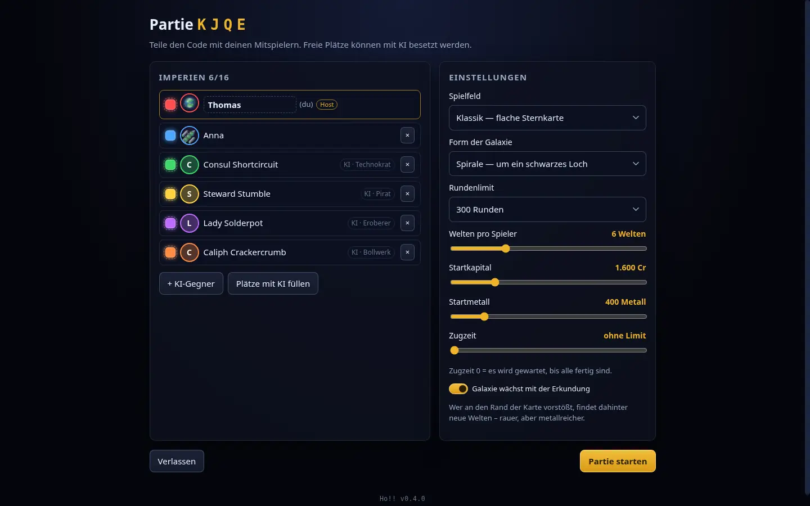
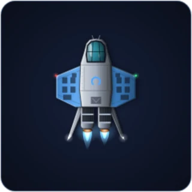
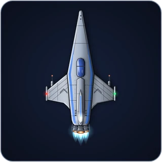
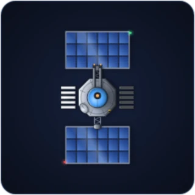
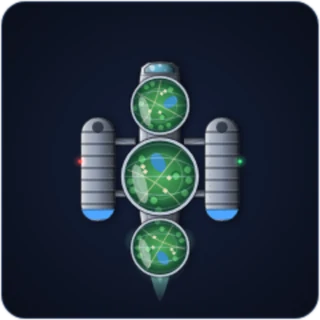
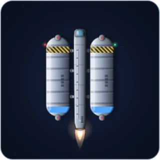
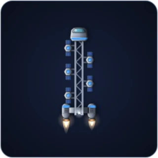
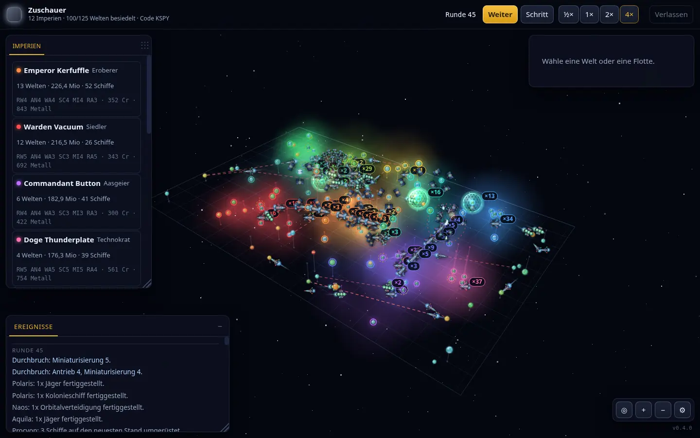
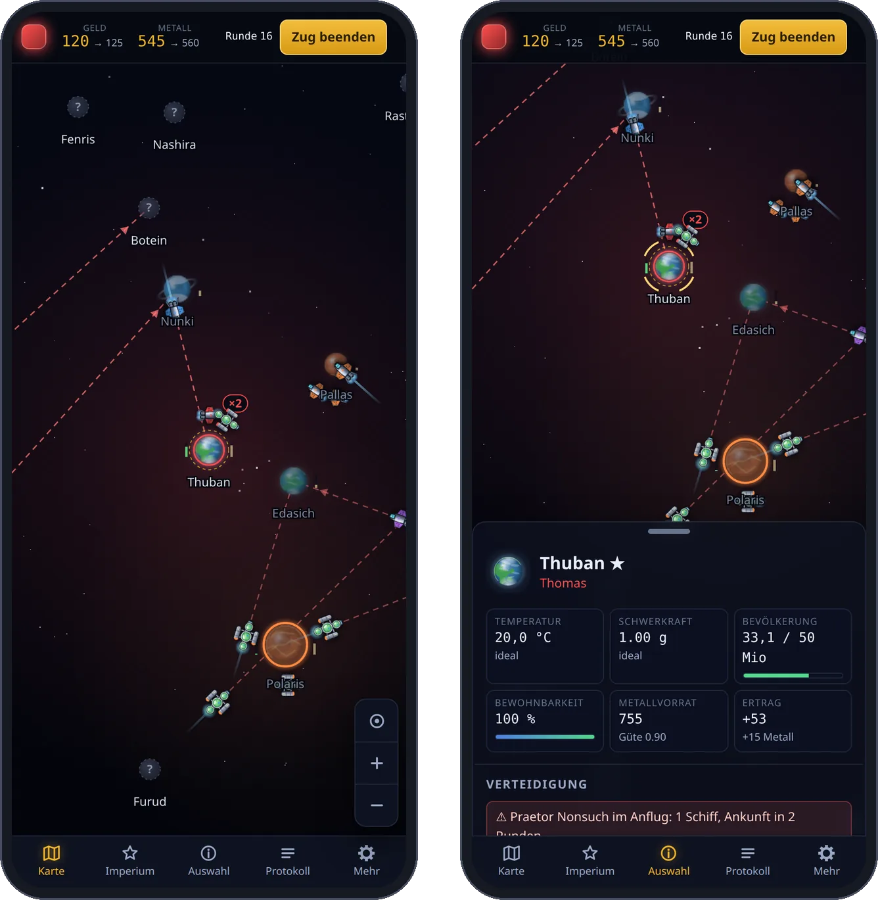

# Spielen

*[English](playing.md) · **Deutsch*** · [← Übersicht](../readme.de.md)

- [Eine Partie beginnen](#eine-partie-beginnen)
- [Spielprinzip](#spielprinzip)
- [Die Schiffstypen](#die-schiffstypen)
- [Geld, Metall und der Haushalt](#geld-metall-und-der-haushalt)
- [Kampf und Eroberung](#kampf-und-eroberung)
- [Form der Galaxie: Streufeld oder Spirale](#form-der-galaxie-streufeld-oder-spirale)
- [Zwei Spielfelder: Klassik und Raum](#zwei-spielfelder-klassik-und-raum)
- [Eine Galaxie ohne Rand](#eine-galaxie-ohne-rand)
- [Die KI-Reiche](#die-ki-reiche)
- [Zusehen](#zusehen)
- [Rangliste und Sieg](#rangliste-und-sieg)
- [Steuerung](#steuerung)
- [Auf Telefon und Tablet](#auf-telefon-und-tablet)
- [Die Optik](#die-optik)

## Eine Partie beginnen

- **Schnell:** *Sofort gegen 5 KI spielen* – Partie anlegen, auffüllen, los.
- **Mit Freunden:** *Neue Partie eröffnen*, den vierstelligen Code weitergeben,
  freie Plätze mit KI füllen, starten. Im LAN erreichen die anderen den Server
  unter `http://<deine-ip>:8080`.
- **Zuschauen:** *Beim Spielen zusehen* startet eine reine KI-Partie, die von
  allein läuft (siehe [Zusehen](#zusehen)).

**Profil.** Im Startbildschirm stehen dein Anzeigename und dein Bild. Klick auf
den Kreis neben dem Namen lädt ein Bild hoch; es wird im Browser quadratisch
zugeschnitten und verkleinert. Mit Konto gehören Name und Bild zum Konto und
gelten auf jedem Gerät, ohne Konto merkt sie sich der Browser. Der Name ist frei
wählbar, darf aber nicht wie ein *anderes* Konto heißen; in einer Partie heißt
jeder anders (notfalls mit Nummer), und weicht der Name vom Konto ab, steht der
Kontoname klein daneben. In der Lobby lassen sich Name und Bild in der eigenen
Zeile ändern.

**Farben.** Ein Klick auf das eigene Farbfeld öffnet die Palette. Jede Farbe gibt
es einmal; vergebene haben eine abgeschnittene Ecke. Die Farbe eines Mitspielers
nimmt nur der Host – dann tauschen beide. Der Host färbt auch die KI-Reiche.

**Einstellungen** legt der Host fest; alle anderen sehen sie als reine Anzeige
mit dem Hinweis, wer sie ändern kann:

| Einstellung | Bedeutung |
|---|---|
| Spielfeld | *Klassik* (flach) oder *Raum* (dreidimensional) |
| Form der Galaxie | *Streufeld* oder *Spirale* mit schwarzem Loch |
| Rundenlimit | 100, 200, 300, 500, unbegrenzt oder *Schnelles Spiel* mit einer eigenen Zahl von 20 bis 99 |
| Welten pro Spieler | 3–14 |
| Startkapital, Startmetall | Kasse zu Beginn |
| Zugzeit | 0 = es wird gewartet, bis alle fertig sind |
| Galaxie wächst | siehe [Eine Galaxie ohne Rand](#eine-galaxie-ohne-rand); aus ergibt eine feste Karte |

**Verbindung.** Ein getrennter Spieler blockiert die Runde nicht – er wird
übersprungen und kann jederzeit zurückkehren (der Platz wird im Browser
gespeichert). Mit Anmeldung lässt sich eine Partie auch auf einem anderen Gerät
fortsetzen: Das Startmenü zeigt sie unter *Deine Partien auf einem anderen
Gerät*, *Hier weiterspielen* holt den Platz herüber, und das erste Gerät kehrt
ins Startmenü zurück. Die anderen Spieler merken davon nichts. Wer über *Verlassen* aussteigt, gibt den Platz endgültig auf: das
Reich bleibt stehen und wird übersprungen. Partien ohne verbundene Spieler werden
nach zwei Stunden aufgeräumt.

## Spielprinzip

Alle ziehen **gleichzeitig**. Jeder erteilt seine Befehle und klickt
*Zug beenden*; sobald alle fertig sind (oder die Zugzeit abläuft), rechnet der
Server die Runde ab – Forschung, Bau, Umrüstung, Terraforming, Bewegung, Kampf,
Kolonisierung, Wirtschaft.

| Begriff | Bedeutung |
|---|---|
| **Ideal** | 20 °C und 1,0 g. Je näher eine Welt daran liegt, desto mehr Menschen leben dort und desto mehr Geld bringt sie. |
| **Terraforming** | Kostet jede Runde das eingestellte Budget und schiebt Temperatur und Schwerkraft Richtung Ideal. Extreme Welten brauchen erst höhere **Radikaltechnik**. |
| **Metall** | Wird auf den eigenen Welten gefördert, in einen gemeinsamen Vorrat gelegt und beim Schiffsbau verbraucht. Der Vorrat eines Planeten erschöpft sich; danach liefert er im Tiefbau noch ein Zehntel. |
| **Reichweite** | Abstand vom nächsten *bewohnten eigenen* Planeten. Neue Kolonien sind damit Sprungbretter; Tanker erweitern den Radius. |
| **Technikstand** | Schiffe werden mit dem Stand ihres Baujahrs gebaut und behalten ihn. Höhere Stufen machen Schiffe besser *und teurer* – **Miniaturisierung** senkt die Kosten wieder. Veraltete Schiffe lassen sich in einer Werft **umrüsten**. |
| **Abwehrbatterie** | Jede bewohnte Welt verteidigt sich selbst, proportional zur Bevölkerung. |
| **Orbitalverteidigung** | Billige Satelliten, die im Orbit bleiben. Selbst fliegen können sie nicht, aber ein **Transporter** bringt bis zu fünf davon zu einer anderen eigenen Welt. Ab fünf Stück spannen sie einen Schild auf. |

## Die Schiffstypen

Sechs Klassen, jede mit eigener Aufgabe. Gebaut wird in der Werft einer eigenen
Welt; ein Klick auf ein Schiff dort – oder *Schiffstypen ansehen* in der Hilfe
(`H`) – öffnet den Steckbrief mit den aktuellen Werten.

| | |
|---|---|
|  | **Späher** – der schnellste Typ mit großer Reichweite. Erst ein Späher deckt Temperatur, Schwerkraft und Metallvorrat einer Welt auf. Waffenlos und zerbrechlich: feindlichen Flotten lieber ausweichen. |
|  | **Jäger** – das Rückgrat jeder Flotte, mit Waffen und Schilden. Wer den Orbit hält und Abwehrbatterie und Orbitalverteidigung bricht, erobert die Welt. Kurze Reichweite – für Angriffe tief im Feindgebiet einen Tanker mitschicken. |
|  | **Orbitalverteidigung** – ein Satellit, der direkt im Orbit der Bauwelt entsteht und dort bleibt. Billig, zäh und kräftig bewaffnet; ab fünf Stück spannen sie einen Schild auf. Eine Welt mit Satelliten fällt nicht kampflos. |
|  | **Kolonieschiff** – setzt 8 Mio. Siedler auf einer freien Welt ab und geht dabei auf. Über einer eigenen, noch nicht vollen Welt stockt *Siedler hier absetzen* die Bevölkerung auf. Langsam und wehrlos – Geleitschutz lohnt sich. |
|  | **Tanker** – kämpft nicht, gibt aber der ganzen Flotte seine Reichweite, mehr als doppelt so viel wie ein Jäger. Jeder weitere Tanker in derselben Flotte bringt +15 %. |
|  | **Transporter** – nimmt im Orbit einer eigenen Welt bis zu fünf Satelliten an Bord und setzt sie über einer anderen eigenen Welt wieder aus; so wandert die Verteidigung dorthin, wo Gefahr droht. Geladene Satelliten kämpfen nicht und gehen mit dem Transporter verloren. Verlängert die Reichweite der Flotte nicht. |

Die Grundwerte bei Technikstufe 1 – Forschung verbessert sie, Neubauten bekommen
den jeweils aktuellen Stand:

| Typ | Kosten | Angriff | Hülle | Tempo | Reichweite |
|---|---|---|---|---|---|
| Späher | 8 Cr · 3 Metall | – | 10 | 71 Lj/R | 323 Lj |
| Jäger | 14 Cr · 7 Metall | 5 | 22 | 42 Lj/R | 170 Lj |
| Orbitalverteidigung | 10 Cr · 5 Metall | 6 | 34 | – | – |
| Kolonieschiff | 30 Cr · 12 Metall | – | 16 | 34 Lj/R | 221 Lj |
| Tanker | 18 Cr · 6 Metall | – | 20 | 38 Lj/R | 442 Lj |
| Transporter | 20 Cr · 8 Metall | – | 26 | 38 Lj/R | 442 Lj |

Eine Flotte fliegt so schnell wie ihr langsamstes Schiff und so weit wie ihr
bestes (plus Tanker). Jedes Schiff hat die Farbe seines Reiches – beim Jäger etwa
die Streifen am Rumpf.

## Geld, Metall und der Haushalt

Abgebucht wird am Rundenende in fester Reihenfolge: **Forschung, Schiffsbau,
Umrüstung, Terraforming** – die **Einnahmen kommen zuletzt** und bezahlen erst
die nächste Runde. Fürs Bauen steht also *Geld minus Forschungsanteil* bereit,
und zwar für alle Werften zusammen. Ein Durchbruch in derselben Runde macht
Schiffe teurer, weil sie mit dem neuen Stand gebaut werden.

Damit das niemand im Kopf rechnen muss:

- Die Kopfleiste zeigt **jetzt → nächste Runde**, etwa `Geld 1.600 → 811`.
- Ein Klick (oder der Mauszeiger) auf Geld oder Metall öffnet den **Haushalt**:
  Bestand, jeder Posten in Abbuchungsreihenfolge, Einnahmen und Förderung,
  darunter das Ergebnis. Die Vorschau rechnet mit genau den Regeln des Servers;
  nur Kämpfe und Eroberungen in derselben Runde können die Einnahmen noch ändern.
- **Angenommen wird nur, was bezahlbar ist.** Reicht es nicht mehr, ist `+` in
  der Werft gesperrt, und der Server lehnt den Auftrag mit einem Hinweis ab.
  Zieht man danach den Forschungsanteil hoch, bleibt er beim höchsten Wert
  stehen, bei dem die Aufträge noch aufgehen – **Aufträge gehen vor**. Ein Bau,
  der am Rundenende am Geld scheitert, kommt dadurch nicht vor.

## Kampf und Eroberung

Treffen in einem Orbit feindliche Flotten aufeinander, wird gekämpft – vorn
steht, wer austeilt, dahinter, wer beschützt wird. Wer abfliegt, während ein
bewaffneter Gegner im Orbit steht, wird **abgefangen** und muss noch drei
Gefechtsrunden überstehen. Jede Schlacht lässt sich nachträglich ansehen: ein
Klick auf die Meldung öffnet die Aufzeichnung.

Eine Welt fällt, wenn ein Angreifer den Orbit hält und weder
Orbitalverteidigung noch Abwehrbatterie überlebt haben. Die Bevölkerung geht
dabei zurück, der Rest wechselt den Besitzer.

## Form der Galaxie: Streufeld oder Spirale

*Streufeld* verteilt die Welten gleichmäßig. *Spirale* baut eine Galaxie, wie man
sie sich vorstellt: zwei oder drei logarithmische Arme um einen dichten Kern, und
in der Mitte ein **schwarzes Loch** mit Namen wie *Charybdis* oder *Nyx*.

Das Loch ist Gelände, kein Hintergrund. Um den Schlund liegt eine **Sperrzone**
(gestrichelter Ring): dort entsteht keine Welt, und keine Flotte fliegt hinein.
Wer ein Ziel dahinter anfliegt, wird **automatisch außen herum** geführt. Der Weg
wird länger und kostet Runden; auch die **Reichweite** misst den fliegbaren Weg,
nicht die Luftlinie – Welten hinter dem Loch liegen spielerisch weiter weg, als sie
aussehen. Der Reichweiten-Umriss auf der Karte hat deshalb zum Loch hin eine Delle,
und *Flotte hierher* ist für unerreichbare Welten von vornherein gesperrt.

Eine Spirale wächst nach außen: Stößt jemand an die Armspitzen vor, reichen die
Arme weiter, und neue Welten entstehen entlang der Arme.

## Zwei Spielfelder: Klassik und Raum

*Klassik* ist die flache Sternkarte. *Raum* verteilt dieselbe Partie auf drei
Dimensionen: die Welten liegen in einer **Linse**, mittig dicker, zum Rand hin
dünner. Entfernungen, Reichweite und Scanner rechnen dann räumlich.

Drei Lesehilfen halten den Raum lesbar: ein **Gitter** in der Mittelebene, ein
**Lot** von jeder Welt auf dieses Gitter (daran liest man die Höhe ab) und eine
Abstufung von Größe und Helligkeit nach Entfernung. Steuerung siehe
[Steuerung](#steuerung).

## Eine Galaxie ohne Rand

Kommt eine Flotte oder besiedelte Welt der Grenze näher als 200 Lj, schiebt sich
die Karte dort hinaus und ein neuer Streifen Welten entsteht – höchstens einer pro
Runde. Je weiter draußen, desto unwirtlicher die Welten (extremere Temperatur und
Schwerkraft), dafür mit mehr und besserem Metall. Draußen zu siedeln lohnt sich,
kostet aber Terraforming und Radikaltechnik. Mit 16 KI wächst die Karte von 96
auf rund 390 Welten in 120 Runden. Abschaltbar in der Lobby.

## Die KI-Reiche

KI-Reiche treten unter eigenem Namen an – von *Admiral Wobblebeard* bis *Czarina
Candyfloss* – und jedes mit eigenem Charakter:

| Charakter | Spielweise |
|---|---|
| **Eroberer** | sucht sich einen Rivalen und rollt ihn Welt für Welt auf |
| **Siedler** | breitet sich aus und schlägt nur zurück |
| **Technokrat** | kommt spät, dafür mit besserer Technik |
| **Pirat** | schickt schnelle Rudel gegen schwache Kolonien |
| **Bollwerk** | mauert sich mit Satelliten ein, bis es ausbricht |
| **Aasgeier** | holt sich, was die anderen übrig lassen |

Sie merken sich, wer sie angegriffen hat, verbünden sich stillschweigend gegen
einen davonziehenden Spitzenreiter und werden ungeduldig, je länger die Partie
dauert.

Angegriffen wird nur, wenn die Flotte die Abwehr in **einem Zug** brechen kann –
die Abwehrbatterie wächst jede Runde aus der Bevölkerung nach, Belagern bringt
nichts. Fällt ein Reich auf drei bekannte Welten zurück, wird es zum
**Kriegsziel**: die Flotten sammeln sich und schlagen erst zu, wenn es für den
Gnadenstoß reicht.

### Schwierigkeit

Jedes KI-Reich spielt auf einer von zwei Stufen. In der Lobby schaltet der Host sie
per Tipp auf den Knopf neben der KI um; *Sofort gegen 5 KI spielen* würfelt sie für
jeden Gegner.

| Stufe | Was sie tut |
|---|---|
| **Normal** | spielt ihren Charakter wie oben beschrieben |
| **Schwer** | wächst schneller und lernt aus Fehlern |

Ein schweres Reich baut jedes Kolonieschiff in der Werft direkt neben der freien
Welt, für die es gedacht ist, und schickt es auf kurzem Weg dorthin – ein Schiff pro
Welt, eine gute Welt in der Nähe vor einer etwas besseren in der Ferne –, statt alle
von der Hauptwelt quer durchs Reich zu schicken. Es terraformt dort, wo ein Credit
die meisten Menschen bringt. Außerdem führt es
Kriegstagebuch. Ein gescheiterter Angriff wird nicht mit
derselben Stärke wiederholt – diese Welt braucht beim nächsten Mal deutlich mehr,
und ihr Besitzer gilt überall als stärker; Erfolge machen es wieder mutiger. Es
rechnet mit feindlichen Flotten, die binnen zwei Runden zu Hilfe kommen können,
ruft einen Angriff zurück, dessen Ziel inzwischen zu stark geworden ist, und meidet
Welten, auf dem Weg zu denen seine Kolonieschiffe abgeschossen wurden.

Außerdem teilt es Flotten im Flug. Eine Angriffsflotte mit Feuerkraft übrig
spaltet einen Trupp gegen eine zweite, schwächere Welt ab, die er noch in derselben
Runde erreicht – zum Reagieren bleibt keine Runde. Und eine kleine fremde Flotte
auf dem Weg zu einer freien Welt (meist ein Kolonieschiff) trifft dort womöglich
schon auf ein paar seiner Jäger. Es sieht dabei nur, was du auch sehen würdest:
Kurs, Ankunft und Zahl der Schiffe, nicht deren Art.

## Zusehen

*Beim Spielen zusehen* setzt eine Partie mit 4 bis 16 KI-Reichen auf. Es gibt
kein eigenes Reich, dafür liegt alles offen: jede Welt, jede Flotte samt
Zusammensetzung, das vollständige Protokoll und eine Tabelle aller Reiche.

Oben rechts sitzen **Pause**, **Schritt** und die Geschwindigkeiten ½× bis 4×
(1× ist eine Runde alle 1,5 Sekunden); die Leertaste hält an. Der Partiecode oben
links lässt weitere Zuschauer unter *Beitreten* dazukommen. Zusehen geht nur bei
reinen KI-Partien – sonst sähe ein Zuschauer die Karten aller Spieler.

## Rangliste und Sieg

Die Rangliste ordnet die Reiche nach **Bevölkerung**, bei Gleichstand nach Welten,
dann nach Schiffen. Danach wird auch gewertet: Wer beim Rundenlimit die meisten
Einwohner hat, gewinnt. Ohne Rundenlimit gewinnt, wer als Letzter übrig bleibt.

Ist die Partie beendet, steht der Gewinner für alle auf dem Bildschirm. *Weiter*
öffnet einen Dialog dazu, wie es weitergeht: Nur der Gastgeber kann die Partie
um weitere Runden verlängern, statt sie enden zu lassen; alle anderen können
nur zwischen Rückkehr zur Startseite und Bleiben wählen.

## Steuerung

| Aktion | Eingabe |
|---|---|
| Karte bewegen / zoomen | Ziehen, Mausrad, `+` / `−`, Knöpfe oben rechts |
| Auswählen | Linksklick auf Welt oder Flotte |
| Kurs setzen | Flotte wählen, dann **Rechtsklick** (oder Shift-Klick) auf die Zielwelt – oder Zielwelt anklicken und im Panel *Flotte hierher* |
| Sehen, wohin Flotten fliegen | Jede Kurslinie beginnt an ihrer Flotte – Flotten im Orbit warten auf der Seite zu ihrem Ziel – und endet in einer Pfeilspitze. Flotte auswählen oder darauf zeigen: Ihre Linie wird hervorgehoben, mit den Runden bis zur Ankunft |
| Flotte teilen | Flotte wählen, *Flotte teilen …*, dann Schiffe von einer Spalte in die andere ziehen – Antippen verschiebt ein einzelnes Schiff. *Jedes Schiff als eigene Flotte* macht aus der rechten Spalte Einzelflotten; *Alle einzeln* zerlegt die ganze Flotte auf einmal (etwa Kolonieschiffe für mehrere Welten). Das geht auch im Flug: Beide Teile fliegen weiter zum selben Ziel, bis die neue Flotte einen eigenen Kurs bekommt |
| Zug beenden | Knopf in der Mitte der Kopfleiste oder `Leertaste` |
| Haushalt ansehen | Klick oder Zeiger auf Geld bzw. Metall in der Kopfleiste |
| Karte einpassen | `F` |
| Nur Eigenes hervorheben | `E` gedrückt halten – alles, was dir nicht gehört, tritt weit zurück. Oder der Flaggen-Knopf oben rechts: Antippen schaltet um (so am Handy), Gedrückthalten nur solange |
| Auswahl aufheben | `Esc` |
| Hilfe | `H` |
| Fenster verschieben / Größe ändern | Titelleiste ziehen zum Verschieben; an jeder Kante oder Ecke ziehen für die Größe |
| Fenster minimieren | **−** in der Titelleiste oder Doppelklick darauf: Das Fenster wird zum Icon in der Kopfleiste (★ Forschung/Imperium/Rangliste, ☰ Ereignisse/Funk – mit der Zahl ungelesener Funksprüche). Ein Klick auf das Icon holt es an seinen Platz zurück. Position, Größe und Zustand bleiben gespeichert |
| Funk (Chat) | Reiter *Funk* im Protokollfenster. Ungesehene Nachrichten erscheinen als Hinweis und werden am Reiter gezählt – antippen, um zu antworten. Smileys wie `:)` `:(` `:D` `;)` `<3` werden zu Emojis, ebenso Codes wie `:sad:` `:rocket:` `:thumbsup:`; der 🙂-Knopf neben dem Feld zeigt alle |
| Menü: Anzeige, Ton, Verlassen | Zahnrad oben rechts, neben Einpassen und Zoom |
| Für alle anhalten | Nur der Gastgeber, in Partien mit Rundentimer: Pause-Knopf neben *Zug beenden* oder `P` – der Timer steht und keine Runde wird ausgewertet, bis es weitergeht; Befehle und Chat funktionieren weiter |
| Partie verlassen | *Partie verlassen* im Menü (Zahnrad oben rechts) |

Zusätzlich im **Raum**-Spielfeld:

| Aktion | Eingabe |
|---|---|
| Kamera drehen | Ziehen |
| Blickpunkt verschieben | **Shift**+Ziehen (oder mittlere Taste) |
| Draufsicht | `T` |

## Auf Telefon und Tablet

Ist das Fenster **schmaler als 900** oder **niedriger als 560 Punkte**, baut sich
die Oberfläche um – Telefone hoch und quer, Tablets wie das iPad hochkant:

- Statt der schwebenden Fenster gibt es eine **Leiste am unteren Rand**
  (Karte · Reich · Auswahl · Protokoll · Mehr); immer nur ein **Blatt** ist offen.
- Hochkant liegt das Blatt unten, quer an der rechten Seite.
- Eine Welt antippen schlägt ihr Blatt auf und rückt sie in den freien Teil der
  Karte; auf leeren Raum tippen klappt es zu.
- Die Kopfleiste wird einzeilig; *Partie verlassen* steht unter *Mehr*.

| Geste | Klassik | Raum |
|---|---|---|
| Ein Finger ziehen | Karte schieben | Kamera drehen |
| Zwei Finger spreizen / zusammenziehen | zoomen | zoomen |
| Zwei Finger schieben | Karte schieben | Blickpunkt verschieben |
| Tippen | auswählen | auswählen |

Einen Kurs setzt man ohne Rechtsklick: Flotte antippen, Zielwelt antippen, im
Blatt *Flotte hierher*.

Ein Tablet im Querformat behält die schwebenden Fenster; auf jedem Touchscreen
wachsen Knöpfe, Reiter und Griffe auf Fingerkuppengröße.

## Die Optik

Die Planeten folgen bewusst dem Stil des Originals: glänzende, satt gefärbte
Kugeln, bei denen die **Farbe die Temperatur** (blau = eisig bis rot = glühend)
und die **Größe die Schwerkraft** zeigt. Je bewohnbarer eine Welt wird, desto
erdähnlicher sieht sie aus – Ozeane, Kontinente mit zerklüfteten Küsten, Wolken
und Polkappen. Terraforming sieht man so direkt auf der Karte.

Besiedelte Welten färben ihre Umgebung in der Farbe ihres Reiches; benachbarte
Welten verschmelzen zu einer Fläche, sodass man auf einen Blick sieht, wem welche
Ecke gehört. Die Schiffe sind von Hand gezeichnet – jede Klasse mit eigener
Silhouette, Triebwerksglühen, Panelfugen, Positionslichtern und Spielerfarbe; das
Kolonieschiff erkennt man an seinen drei Wohnkuppeln.
