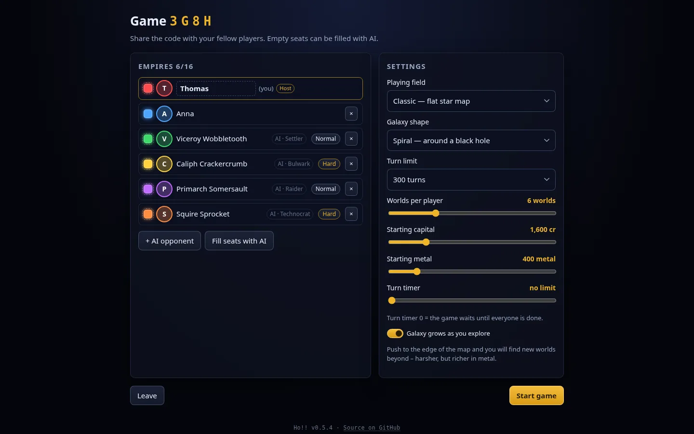
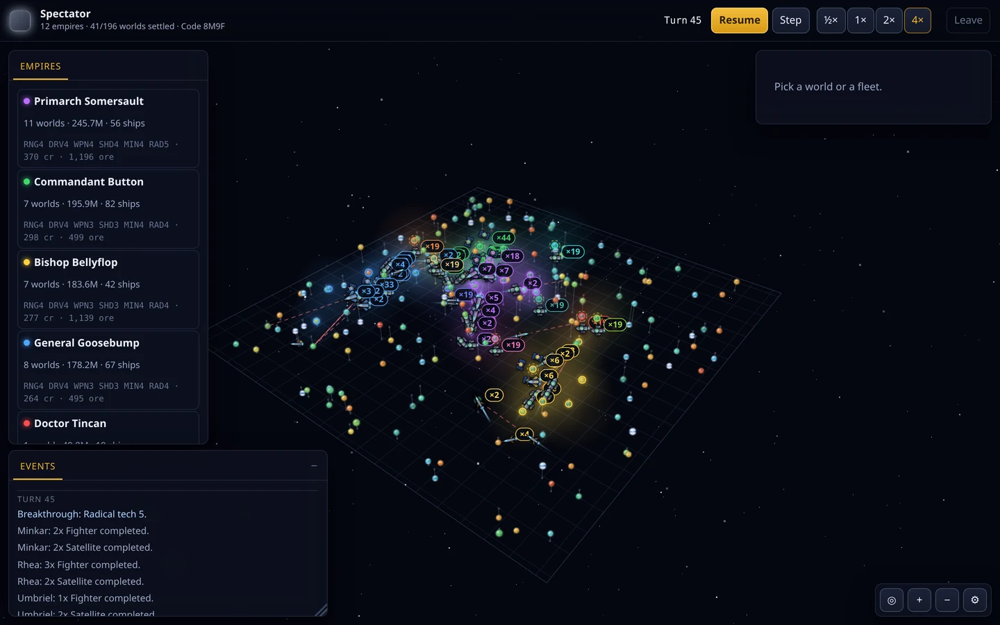

# Playing

***English** · [Deutsch](playing.de.md)* · [← Overview](../readme.md)

- [Starting a game](#starting-a-game)
- [How it plays](#how-it-plays)
- [Money, metal and the budget](#money-metal-and-the-budget)
- [Combat and conquest](#combat-and-conquest)
- [Galaxy shape: scatter or spiral](#galaxy-shape-scatter-or-spiral)
- [Two playing fields: classic and space](#two-playing-fields-classic-and-space)
- [A galaxy without an edge](#a-galaxy-without-an-edge)
- [The AI empires](#the-ai-empires)
- [Watching](#watching)
- [Ranking and victory](#ranking-and-victory)
- [Controls](#controls)
- [On a phone](#on-a-phone)
- [The look](#the-look)

## Starting a game

- **Quick:** *Play 5 AI right away* – creates a game, fills it and starts.
- **With friends:** *Host a new game*, pass on the four-letter code, fill the
  empty seats with AI and start. On a LAN the others reach the server at
  `http://<your-ip>:8080`.
- **Watch:** *Watch a game* starts an all-AI game that runs by itself (see
  [Watching](#watching)).

**Profile.** The start screen shows your display name and picture. Click the
circle next to the name to upload a picture; the browser crops and shrinks it.
With an account, name and picture belong to the account and follow you to every
device; without one, the browser remembers them. The name is free to choose but
may not match *another* account; within a game every name is unique (numbered if
necessary), and when the name differs from the account, the account name is shown
next to it. In the lobby you can change name and picture in your own row.

**Colours.** Click your colour swatch to open the palette. Each colour exists
once; taken ones have a clipped corner. Only the host can take another player's
colour – the two then swap. The host also colours the AI empires.

**Settings** are up to the host; everyone else sees them read-only, with a note
saying who can change them:

| Setting | Meaning |
|---|---|
| Playing field | *Classic* (flat) or *Space* (three-dimensional) |
| Galaxy shape | *Scatter* or *Spiral* with a black hole |
| Turn limit | 100, 200, 300, 500 or unlimited |
| Worlds per player | 3–14 |
| Starting capital, starting metal | Treasury at the start |
| Turn timer | 0 = the game waits until everyone is done |
| Galaxy grows | see [A galaxy without an edge](#a-galaxy-without-an-edge); off gives a fixed map |

**Connection.** A disconnected player does not block the turn – they are skipped
and can return at any time (the seat is stored in the browser). Anyone who exits
via *Leave* gives the seat up for good: the empire stays on the map and is
skipped. Games without connected players are cleaned up after two hours.

## How it plays

Everyone moves **at the same time**. Each player issues their orders and clicks
*End turn*; once everyone is done (or the turn timer runs out) the server resolves
the turn – research, building, refits, terraforming, movement, combat,
colonisation, economy.

| Term | Meaning |
|---|---|
| **Ideal** | 20 °C and 1.0 g. The closer a world is to it, the more people live there and the more money it brings in. |
| **Terraforming** | Costs the set budget every turn and pushes temperature and gravity towards the ideal. Extreme worlds need a higher level of **radical tech** first. |
| **Metal** | Mined on your own worlds, pooled and consumed when building ships. A planet's reserve runs out; after that, deep mining still yields a tenth. |
| **Range** | Distance from your nearest *inhabited own* planet. New colonies are therefore stepping stones; tankers widen the radius. |
| **Tech level** | Ships are built with the level of their build year and keep it. Higher levels make ships better *and more expensive* – **miniaturisation** brings the cost back down. Outdated ships can be **refitted** at a shipyard. |
| **Defence battery** | Every inhabited world defends itself, in proportion to its population. |
| **Orbital defence** | Cheap, immobile satellites that stay in orbit for good. From five upwards they raise a shield. |

The ship classes – scout, fighter, orbital defence, colony ship, tanker – are
explained by the in-game data sheet (click a ship in the shipyard, or *Browse
ship types* in the help).

## Money, metal and the budget

At the end of the turn charges happen in a fixed order: **research, shipbuilding,
refits, terraforming** – **income arrives last** and only pays for the next turn.
So what is available for building is *money minus the research share*, across all
shipyards together. A breakthrough in the same turn makes ships more expensive,
because they are built at the new level.

So that nobody has to work this out in their head:

- The top bar shows **now → next turn**, e.g. `Money 1,600 → 811`.
- Clicking (or hovering over) money or metal opens the **budget**: balance, every
  charge in booking order, income and mining, and the result underneath. The
  forecast uses exactly the server's rules; only battles and conquests in the same
  turn can still change the income.
- **Only affordable orders are accepted.** When the money runs out, `+` in the
  shipyard is disabled and the server rejects the order with a notice. Raising the
  research share afterwards stops at the highest value at which the orders still
  add up – **orders come first**. A build that fails for lack of money at the end
  of the turn therefore does not happen.

## Combat and conquest

When hostile fleets meet in an orbit, they fight – those who deal damage at the
front, those who need protecting behind. A fleet that leaves while an armed enemy
holds the orbit is **intercepted** and has to survive three more rounds of combat.
Every battle can be replayed afterwards: click its notice to open the recording.

A world falls when an attacker holds the orbit and neither orbital defence nor
defence battery survived. The population drops in the process, the rest changes
hands.

## Galaxy shape: scatter or spiral

*Scatter* spreads the worlds evenly. *Spiral* builds a galaxy the way you picture
one: two or three logarithmic arms around a dense core, and at the centre a
**black hole** with a name such as *Charybdis* or *Nyx*.

The hole is terrain, not a backdrop. Around the maw lies a **no-go zone** (dashed
ring): no world forms there and no fleet flies into it. A fleet heading for a target
behind it is **routed around automatically**. The path gets longer and costs turns;
**range** also measures the flyable path rather than the straight line – worlds
behind the hole are further away in play than they look. The range outline on the
map therefore has a dent towards the hole, and *Fleet here* is disabled from the
start for unreachable worlds.

A spiral grows outwards: push to the tips of the arms and the arms reach further,
with new worlds forming along them.

## Two playing fields: classic and space

*Classic* is the flat star map. *Space* spreads the same game across three
dimensions: the worlds lie in a **lens**, thicker in the middle, thinner towards the
rim. Distances, range and scanners then compute in three dimensions.

Three reading aids keep space legible: a **grid** in the mid-plane, a **plumb
line** from every world down to it (that is how you read its height) and a grading
of size and brightness by distance. For the controls see [Controls](#controls).

## A galaxy without an edge

When a fleet or settled world comes closer than 200 ly to the border, the map
pushes out there and a new strip of worlds appears – at most one per turn. The
further out, the harsher the worlds (more extreme temperature and gravity), but with
more and better metal. Settling out there pays off, but costs terraforming and
radical tech. With 16 AI the map grows from 96 to around 390 worlds in 120 turns.
It can be switched off in the lobby.

## The AI empires

AI empires enter under names of their own – from *Admiral Wobblebeard* to *Czarina
Candyfloss* – and each with a personality of its own:

| Personality | Play style |
|---|---|
| **Conqueror** | picks a rival and rolls it up world by world |
| **Settler** | spreads out and only fights back |
| **Technocrat** | strikes late, with better technology |
| **Raider** | sends fast packs after weak colonies |
| **Bulwark** | walls itself in with satellites until it breaks out |
| **Vulture** | takes whatever the others leave behind |

They remember who attacked them, quietly gang up on a runaway leader and lose
patience as the game drags on.

They only attack when the fleet can break the defence in **one turn** – the defence
battery regrows from the population every turn, so a siege achieves nothing. When an
empire falls back to three known worlds it becomes the **war target**: the fleets
gather and only strike once there is enough for the killing blow.

## Watching

*Watch a game* sets up a game with 4 to 16 AI empires. There is no empire of your
own; in exchange everything is open: every world, every fleet including its
composition, the full log and a table of all empires.

At the top right sit **Pause**, **Step** and the speeds ½× to 4× (1× is one turn
every 1.5 seconds); the space bar pauses. The game code at the top left lets more
spectators join via *Join*. Watching only works for all-AI games – otherwise a
spectator would see everyone's cards.

## Ranking and victory

The ranking orders the empires by **population**, ties broken by worlds, then by
ships. That is also how the game is decided: whoever has the most people at the
turn limit wins. Without a turn limit, the last empire standing wins.

## Controls

| Action | Input |
|---|---|
| Move / zoom the map | Drag, mouse wheel, `+` / `−` |
| Select | Left click on a world or fleet |
| Set course | Pick a fleet, then **right-click** (or shift-click) the target world – or click the target world and use *Fleet here* in the panel |
| End turn | Button at the top right or `space` |
| Show the budget | Click or hover over money or metal in the top bar |
| Fit the map | `F` |
| Clear selection | `Esc` |
| Help | `H` |
| Move / resize windows | Drag the title bar, or the grip at the bottom right; double-click collapses the log |
| Display and sound | Gear at the bottom right |
| Leave the game | *Leave* at the top right |

Additionally on the **space** field:

| Action | Input |
|---|---|
| Rotate camera | Drag |
| Pan the focus | **Shift**+drag (or middle button) |
| Top-down view | `T` |

## On a phone

When the window is **narrower than 760** or **shorter than 560 points**, the
interface rearranges itself (tested on a 21:9 device, portrait and landscape):

- Instead of the floating windows there is a **bar along the bottom**
  (Map · Empire · Selection · Log · More); only one **sheet** is open at a time.
- In portrait the sheet sits at the bottom, in landscape on the right.
- Tapping a world opens its sheet and moves it into the free part of the map;
  tapping empty space closes it.
- The top bar becomes a single row; *Leave the game* lives under *More*.

| Gesture | Classic | Space |
|---|---|---|
| Drag one finger | pan the map | rotate the camera |
| Spread / pinch two fingers | zoom | zoom |
| Drag two fingers | pan the map | pan the focus |
| Tap | select | select |

Setting a course needs no right click: tap the fleet, tap the target world, use
*Fleet here* in the sheet.

## The look

The planets deliberately follow the style of the original: glossy, richly coloured
spheres where **colour shows temperature** (blue = icy to red = scorching) and
**size shows gravity**. The more habitable a world becomes, the more Earth-like it
looks – oceans, continents with ragged coastlines, clouds and polar caps. So
terraforming is visible right on the map.

Settled worlds tint their surroundings in the colour of their empire; neighbouring
worlds merge into one area, so a glance tells you who owns which corner. The ships
are drawn by hand – each class with its own silhouette, engine glow, panel lines,
navigation lights and player colour; the colony ship is recognisable by its three
habitat domes.
