# Playing

***English** · [Deutsch](playing.de.md)* · [← Overview](../readme.md)

- [Starting a game](#starting-a-game)
- [How it plays](#how-it-plays)
- [The ship classes](#the-ship-classes)
- [Money, metal and the budget](#money-metal-and-the-budget)
- [Combat and conquest](#combat-and-conquest)
- [Alliances](#alliances)
- [Galaxy shape: scatter or spiral](#galaxy-shape-scatter-or-spiral)
- [Two playing fields: classic and space](#two-playing-fields-classic-and-space)
- [A galaxy without an edge](#a-galaxy-without-an-edge)
- [Wormholes](#wormholes)
- [Aliens](#aliens)
- [The AI colonies](#the-ai-colonies)
- [Watching](#watching)
- [Ranking and victory](#ranking-and-victory)
- [Controls](#controls)
- [On a phone or tablet](#on-a-phone-or-tablet)
- [The look](#the-look)

## Starting a game

- **Quick:** *Play 5 AI right away* – creates a game, fills it and starts.
- **With friends:** *Host a new game*, pass on the four-letter code, fill the
  empty seats with AI and start. On a LAN the others reach the server at
  `http://<your-ip>:8080`.
- **Watch:** *Watch a game* starts an all-AI game that runs by itself (see
  [Watching](#watching)).

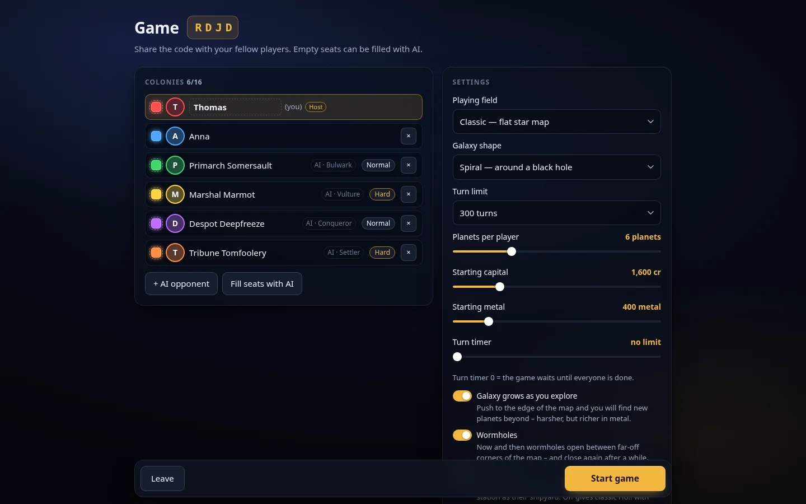

**Profile.** The start screen shows your display name and picture. Click the
circle next to the name to upload a picture; the browser crops and shrinks it.
With an account, name and picture belong to the account and follow you to every
device; without one, the browser remembers them. The name is free to choose but
may not match *another* account; within a game every name is unique (numbered if
necessary), and when the name differs from the account, the account name is shown
next to it. In the lobby you can change name and picture in your own row.

**Colours.** Click your colour swatch to open the palette. Each colour exists
once; taken ones have a clipped corner. Only the host can take another player's
colour – the two then swap. The host also colours the AI colonies.

**Settings** are up to the host; everyone else sees them read-only, with a note
saying who can change them:

| Setting | Meaning |
|---|---|
| Playing field | *Classic* (flat) or *Space* (three-dimensional) |
| Galaxy shape | *Scatter* or *Spiral* with a black hole |
| Turn limit | 100, 200, 300, 500, unlimited, or *Quick game* for a custom number from 20 to 99 |
| Planets per player | 3–14 |
| Starting capital, starting metal | Treasury at the start |
| Turn timer | 0 = the game waits until everyone is done |
| Galaxy grows | see [A galaxy without an edge](#a-galaxy-without-an-edge); off gives a fixed map |
| Wormholes | see [Wormholes](#wormholes) |
| Capital ships | orbital stations and destroyers can be built (see [The ship classes](#the-ship-classes)); off gives classic Ho!! with the small ships only |
| Alliances | colonies can ally (see [Alliances](#alliances)); off makes it everyone against everyone |

**Connection.** A disconnected player does not block the turn – they are skipped
and can return at any time (the seat is stored in the browser). With sign-in a game can also be continued on
another device: the start menu lists it under *Your games on another device*,
*Continue here* brings the seat over and the first device returns to the start
menu. The other players do not notice. Anyone who exits
via *Leave* gives the seat up for good: the colony stays on the map and is
skipped. Games without connected players are cleaned up after two hours.

## How it plays

Everyone moves **at the same time**. Each player issues their orders and clicks
*End turn*; once everyone is done (or the turn timer runs out) the server resolves
the turn – research, building, refits, terraforming, movement, combat,
colonisation, economy.

| Term | Meaning |
|---|---|
| **Ideal** | 20 °C and 1.0 g. The closer a planet is to it, the more people live there and the more money it brings in. |
| **Terraforming** | Costs the set budget every turn and pushes temperature and gravity towards the ideal. Extreme planets need a higher level of **radical tech** first. |
| **Metal** | Mined on your own planets, pooled and consumed when building ships. A planet's reserve runs out; after that, deep mining still yields a tenth. |
| **Range** | Distance from your nearest *inhabited own* planet – or an ally's. Newly settled planets are therefore stepping stones; tankers widen the radius. |
| **Tech level** | Ships are built with the level of their build year and keep it. Higher levels make ships better *and more expensive* – **miniaturisation** brings the cost back down. Outdated ships can be **refitted** at a shipyard. |
| **Defence battery** | Every inhabited planet defends itself, in proportion to its population. |
| **Orbital defence** | Cheap satellites that stay in orbit. They cannot fly themselves, but a **transporter** carries up to five of them to another planet of yours. From five upwards they raise a shield. |
| **Recycling** | A research field of its own. From level 2 on, ships and satellites at one of your shipyards can be taken apart right away: that costs money and brings back part of the metal of their build price. Level 2 returns 25% of the metal for 50% of the money; every level improves that until level 16 reaches the limit – 80% of the metal for 5% of the money. The fleet goes as a whole (split it first), satellites by count, the oldest first. |

## The ship classes

Seven classes, each with a job of its own, plus the orbital station that builds the
destroyers. Ships are built at the shipyard of one of your planets; clicking a ship
there – or *Browse ship types* in *How to play* (`H`) – opens its data sheet with
the current values.

| | |
|---|---|
| 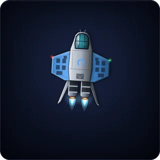 | **Scout** – the fastest class, with a long range. Only a scout reveals a planet's temperature, gravity and metal reserve. Unarmed and fragile: better steer clear of enemy fleets. |
| 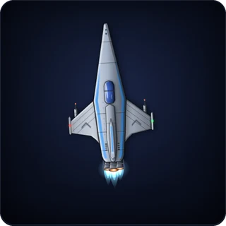 | **Fighter** – the backbone of every fleet, with weapons and shields. Whoever holds the orbit and breaks the defence battery and the orbital defence takes the planet. Short range – send a tanker along for strikes deep in enemy space. |
| 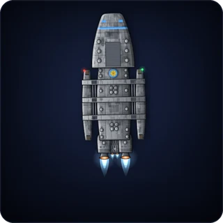 | **Destroyer** – the capital ship, and the anchor of a fleet. It costs as much as ten fighters and fights about as well, but in its own way: eight guns fire at different targets every round, and its hull draws the fire like four fighters. In orbit of a planet of yours it repairs its whole fleet, 20% of every hull per turn without a battle there. Weak against planets – conquering stays the fighters' job. Needs Weapons 5 and Shields 5, and is only built at a finished orbital station. Every destroyer carries a historical ship name, which you can change in the fleet panel. |
| 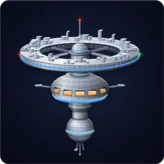 | **Orbital station** – the shipyard in orbit where destroyers are built, and fighters cost 25% less there. It costs as much as a destroyer, is paid when ordered and is ready after 3 turns; until then a construction site stands in orbit. One per planet, from Weapons 5 and Shields 5 on planets with at least 20M people. Once ready it takes over the planet's shipyard: click the station on the map to build. It never flies and cannot be transported. In a battle for its planet it fights along – a hull like a destroyer that draws the fire, and four guns, about as strong as four satellites – and as long as it stands, the planet cannot be conquered. Shot down, or the planet lost, and it is gone; without a battle it repairs 20% of its hull per turn. Only in games with capital ships. |
| 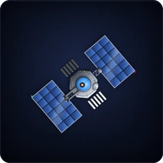 | **Orbital defence** – a satellite placed straight into orbit of the planet that builds it, where it stays. Cheap, tough and well armed; from five upwards they raise a shield. A planet with satellites does not fall without a fight. |
| 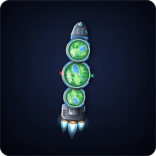 | **Colony ship** – lands 8M settlers on a free planet and is used up in the process. Over a planet of yours that is not yet full, *Drop settlers here* tops up the population. Slow and defenceless – an escort pays off. |
| 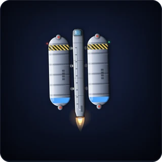 | **Tanker** – does not fight, but gives the whole fleet its range, more than twice that of a fighter. Every further tanker in the same fleet adds +15%. |
| 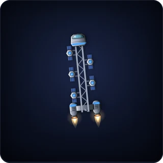 | **Transporter** – takes up to five satellites aboard in orbit of a planet of yours and sets them down above another one, so the defence moves to wherever danger looms. Satellites aboard do not fight and are lost with the transporter. Does not extend the fleet's range. |

Base values at tech level 1 – research improves them, and new ships are built at
the current level:

| Class | Cost | Attack | Hull | Speed | Range |
|---|---|---|---|---|---|
| Scout | 8 cr · 3 metal | – | 10 | 71 ly/t | 323 ly |
| Fighter | 14 cr · 7 metal | 5 | 22 | 42 ly/t | 170 ly |
| Destroyer | 140 cr · 80 metal | 8 × 5 | 320 | 29 ly/t | 170 ly |
| Orbital station | 140 cr · 80 metal | 4 × 5.6 | 320 | – | – |
| Orbital defence | 10 cr · 5 metal | 6 | 34 | – | – |
| Colony ship | 30 cr · 12 metal | – | 16 | 34 ly/t | 221 ly |
| Tanker | 18 cr · 6 metal | – | 20 | 38 ly/t | 442 ly |
| Transporter | 20 cr · 8 metal | – | 26 | 38 ly/t | 442 ly |

A fleet flies as fast as its slowest ship and as far as its best one (plus
tankers). Every ship wears the colour of its colony – on the fighter, for example,
the stripes along the fuselage.

## Money, metal and the budget

At the end of the turn charges happen in a fixed order: **research, shipbuilding,
refits, terraforming** – **income arrives last** and only pays for the next turn.
So what is available for building is *money minus the research share*, across all
shipyards together. A breakthrough in the same turn makes ships more expensive,
because they are built at the new level.

So that nobody has to work this out in their head:

- The top bar shows **now → next turn**, e.g. `Money 1,600 → 811`.
- Clicking (or hovering over) money or metal opens the **budget**: balance, every
  charge in booking order, income and mining, and the result underneath. The
  forecast uses exactly the server's rules; only battles and conquests in the same
  turn can still change the income.
- **Only affordable orders are accepted.** When the money runs out, `+` in the
  shipyard is disabled and the server rejects the order with a notice. Raising the
  research share afterwards stops at the highest value at which the orders still
  add up – **orders come first**. A build that fails for lack of money at the end
  of the turn therefore does not happen.

**Research presets:** at the top of the research tab, *+ Save* keeps the current
research share and all weights under a name; one tap on the preset sets them
again, the active one is outlined in gold. Under *Manage* presets can be renamed,
overwritten with the current settings (*Update*) and deleted. The one marked ★ is
set automatically in turn 1 of every new game. Up to eight presets; with an
account they belong to the account and are the same on every device, without
sign-in the browser keeps them.

## Combat and conquest

When hostile fleets meet in an orbit, they fight – those who deal damage at the
front, those who need protecting behind. A fleet that leaves while an armed enemy
holds the orbit is **intercepted** and has to survive three more rounds of combat.
Every battle can be replayed afterwards: click its notice to open the recording.

**Intercepting in flight:** an armed fleet can chase a foreign fleet it sees in
flight – right-click it with your fleet selected, or use *Intercept* in its
panel. Every turn your fleet heads for the point where it meets the target on
its course. Where they come close enough, both stop and fight in open space,
without battery or satellites; a survivor flies on afterwards. A faster fleet
catches up, a slower one only head-on. If the target reaches an orbit, your
fleet follows it there; if it goes out of sight, the chase ends. The AI
colonies intercept too. Intercepting can be switched off in the lobby.

**Fog of war:** you only see what your sensors cover – around your planets and
fleets, shown on the map as a clear area in the dark veil. **Scouts** and planets
with a finished **orbital station** see much farther than the rest; allies share
their sight. Planets out of sight show what they were like when you last saw
them. A foreign fleet in sight gives away its target and arrival only if it is
heading for one of your planets or its target is in sight itself – otherwise you
only see its direction as a short dotted arrow. The numbers of other empires
(planets, population, ships) stay hidden. The AI plays by the same rules. Can be
switched off in the lobby; off, the older, wider sight applies.

A planet falls when an attacker holds the orbit and neither orbital defence nor
defence battery survived. The population drops in the process, the rest changes
hands.

Damage stays with a ship. Only a **destroyer** repairs: in orbit of a planet of
yours its whole fleet gets back 20% of every hull per turn without a battle there.
Its eight guns each pick a target of their own, and it draws the fire like four
fighters – the small ships in its fleet are hit less often.

## Alliances

In the rankings (left window, *Rankings* tab) you can offer any colony an
alliance – **open**, so that everyone learns of it, or **secret**. The other
side accepts or declines; an offer stands for five turns, and after a refusal
you have to wait ten turns before asking the same colony again.

An alliance always binds two colonies:

- **Peace:** allies do not attack each other – neither their fleets nor the
  defences of their planets. Fleets may visit an ally's orbit and stay there.
- **Side by side:** where an ally is attacked, its fleets in the orbit fight
  along. A colony ship may land under an ally's escort.
- **Shared sight:** you see what your ally sees – its planets and fleets count
  as your eyes.
- **Supply:** an ally's inhabited planets supply your fleets as if they were
  your own, so your ships reach further.

Alliances are not passed on: if A is allied with B and B with C, A and C still
fight each other.

**Secret alliances** are known only to the two partners – until someone sees
fleets of both share an orbit in peace, or one partner's fleet over the other's
planet. That observer then knows, and the log tells them where. Either partner
can make a secret alliance **public** at any time, for instance to deter an
attacker.

**Notice** can be given at any time. The alliance then holds for two more turns;
after that, fleets still in the former partner's orbit fight. Keep an eye on
guests in your own orbit.

If only allies are left, with nobody under notice, they win **together**. The
AI colonies form alliances as well (see [The AI colonies](#the-ai-colonies)), and
the host can switch alliances off in the lobby.

## Galaxy shape: scatter or spiral

*Scatter* spreads the planets evenly. *Spiral* builds a galaxy the way you picture
one: two or three logarithmic arms around a dense core, and at the centre a
**black hole** with a name such as *Charybdis* or *Nyx*.

The hole is terrain, not a backdrop. Around the maw lies a **no-go zone** (dashed
ring): no planet forms there and no fleet flies into it. A fleet heading for a target
behind it is **routed around automatically**. The path gets longer and costs turns;
**range** also measures the flyable path rather than the straight line – planets
behind the hole are further away in play than they look. The range outline on the
map therefore has a dent towards the hole, and *Fleet here* is disabled from the
start for unreachable planets.

A spiral grows outwards: push to the tips of the arms and the arms reach further,
with new planets forming along them.

## Two playing fields: classic and space

*Classic* is the flat star map. *Space* spreads the same game across three
dimensions: the planets lie in a **lens**, thicker in the middle, thinner towards the
rim. Distances, range and scanners then compute in three dimensions.

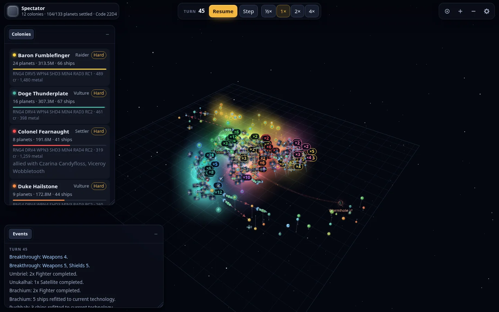

Three reading aids keep space legible: a **grid** in the mid-plane, a **plumb
line** from every planet down to it (that is how you read its height) and a grading
of size and brightness by distance. For the controls see [Controls](#controls).

In space the range is a sphere around every inhabited planet – which cannot be
drawn legibly. So with the *Range* switch the space view marks the **targets** instead:
planets the selected fleet can reach get a blue glow (purple: only through a
wormhole), all others recede. Hovering over a planet shows the line the supply runs
along from your nearest planet, labelled *needed / range* – red if it is too far.

## A galaxy without an edge

When a fleet or settled planet comes closer than 200 ly to the border, the map
pushes out there and a new strip of planets appears – at most one per turn. The
further out, the harsher the planets (more extreme temperature and gravity), but with
more and better metal. Settling out there pays off, but costs terraforming and
radical tech. With 16 AI the map grows from 96 to around 390 planets in 120 turns.
It can be switched off in the lobby.

## Wormholes

From turn 12 on, wormholes open now and then: two mouths far apart – at least
half the map's longer side – each with planets nearby. Only one is open at a
time. A mouth comes into sight like a planet,
within scanner range of your planets and fleets.

- **Jumping:** select a fleet, then click the mouth (or *Fly in* in its panel).
  The fleet flies there, jumps and stands at the other mouth.
- **Where to:** only the first jump tells. From then on you know both ends, the
  map draws the tunnel between them, and the way back works too. Other colonies
  still do not know it.
- **Supply:** range is measured from your inhabited planets as always. An open
  wormhole you know carries it to its far side – a fleet there may fly as far
  as is left after the way from home to the entrance (the purple outline). From
  home straight into the far side, through unknown space, there is no way.
- **Collapse:** a wormhole lives 16–28 turns; in its last three it flickers red.
  Fleets heading for it stop; whoever is on the far side is cut off – unless a
  colony ship founds a new planet there.

Wormholes can be switched off in the lobby. The curious AI personalities –
settler, raider and vulture – use them: a scout looks first, then colony ships
follow to free planets or a pack goes hunting on the far side; the raider also
jumps blind. Before the wormhole collapses they come back.

## Aliens

Now and then aliens appear: an **alien carrier** and several **alien
fighters**. They appear within sight of a planet, a few turns of flight away;
the log names the target. On the map you see the carrier with its fighters
swarming around it like a cloud.

| | |
|---|---|
|  | **Alien carrier** – the heart of the swarm. Three guns, it draws the fire like three fighters and sends out new fighters every turn without a battle. Shoot down every carrier and the swarm breaks off. Cannot be built. |
| 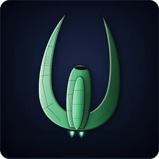 | **Alien fighter** – a little faster than a fighter, otherwise as strong. Alone in the orbit of a planet they do not conquer it – they leave it empty. Cannot be built. |

- **Target:** the colony with the fewest alien attacks so far.
- **Effect:** they do not conquer. A planet whose orbit they hold alone is
  depopulated and becomes free. A colony's last planet is never attacked.
- **Carrier:** replaces lost fighters every turn without a battle. Once all
  carriers are destroyed, the fighters withdraw. Otherwise they withdraw after
  a few planets, after some turns, or after heavy losses.

The host sets their strength in the lobby (or switches them off):

| | Easy | Medium | Strong |
|---|---|---|---|
| First raid | turn 30 | turn 25 | turn 20 |
| Interval (six colonies) | about 15 turns | about 10 turns | about 6 turns |
| Visited colonies | 3+ planets | 3+ planets | 2+ planets |
| Fighters | 3, later up to 9 | 5, later up to 14 | 8, later up to 22 |
| Carriers | 1 | 1 | 2 from 14 fighters on |
| Weapons and shields | like the colony | +1 level | +2 levels |
| Planets per raid | 2 | 3 | 5 |
| Fighters replaced per turn | 1 | 2 | 3 |

Satellites, an orbital station or a fleet in orbit stop them.

## The AI colonies

AI colonies enter under names of their own – from *Admiral Wobblebeard* to *Czarina
Candyfloss* – and each with a personality of its own:

| Personality | Play style |
|---|---|
| **Conqueror** | picks a rival and rolls it up planet by planet |
| **Settler** | spreads out and only fights back |
| **Technocrat** | strikes late, with better technology |
| **Raider** | sends fast packs after weak planets |
| **Bulwark** | walls itself in with satellites until it breaks out |
| **Vulture** | takes whatever the others leave behind |

They remember who attacked them, quietly gang up on a runaway leader and lose
patience as the game drags on.

They also form [alliances](#alliances) – among themselves and with you – and
answer an offer right away. A runaway leader or a common rival brings them
together, and the weak seek protection; nobody allies with whoever hurt it or
stands with its rival. Whoever attacks an ally makes an enemy, and a colony
with known allies is reckoned harder to take – an open alliance deters. Each
personality has its own idea of loyalty: the settler and the bulwark stick
together and show their friends openly, the vulture and the raider prefer
secret alliances and drop an ally that leads, that lies on the ground, or that
they simply need as prey late in the game.

They only attack when the fleet can break the defence in **one turn** – the defence
battery regrows from the population every turn, so a siege achieves nothing. When an
colony falls back to three known planets it becomes the **war target**: the fleets
gather and only strike once there is enough for the killing blow.

### Difficulty

Every AI colony plays at one of two levels. In the lobby the host switches it with a
tap on the button next to the AI; *Play 5 AI right away* rolls it for each opponent.

| Level | What it does |
|---|---|
| **Normal** | plays its personality as described above |
| **Hard** | grows faster and learns from its mistakes |

A hard AI colony builds every colony ship at the shipyard right next to the free planet
it is meant for and sends it there on the short way – one ship per planet, a good
planet nearby before a slightly better one far away – instead of sending them all
across the colony from the home planet. It terraforms where
a credit buys the most people. It also keeps a war diary. A strike that failed is not repeated with the same
force – that planet needs clearly more next time, and its owner is reckoned stronger
everywhere; successes make it bolder again. It counts enemy fleets that can come to
the rescue within two turns, calls back a strike whose target has grown too strong
in the meantime, and avoids planets where its colony ships were shot down.

It also splits fleets in flight. A strike fleet with firepower to spare peels off a
detachment against a second, weaker planet it reaches in the same turn – so there is
no turn left to react. And a small foreign fleet heading for a free planet (most
likely a colony ship) may find a few of its fighters waiting there. It only sees
what you would see: course, arrival and number of ships, not what they are.

A hard AI colony betrays with a plan: its fleets first gather in the ally's orbit
as guests, and only once enough of them are there does it give notice – when
the notice runs out, the battle starts right inside the ally's defences.

### Radio chatter

Now and then an AI colony gets on the radio – with a voice of its own for each
personality, in English: when it first clashes with you, attacks your planets,
takes one or loses one, allies with you or gives notice. The aliens speak up
too, in a language nobody understands. What is said also shows on the comms,
marked 📻 – the ▶ next to it plays it once more, the crosshair takes you to the planet
it is about. A line about a battle comes once
that battle has played out on the map. Many lines name names – your
planet, you, the colony or its destroyer: *"Kepler Prime is mine now, Olena."* In the thick of a battle with you there are short calls on top –
*Open fire!*, *Jackpot!*, *Breach!* – those only sound.

Your own fleets answer too, short and snappy, each with a voice of its own: when
you pick one (*"Yes?"*), send it off (*"On it."*), into battle (*"Charge!"*), to
settle a free planet (*"New home!"*), after a foreign fleet or into a wormhole.
Pick one of your planets with a shipyard and its dock master reports in, by name
(*"Kepler Prime shipyard ready."*) – right away or not at all, not every time, and with over a hundred
lines rarely the same twice.

It stays sparse: only what concerns you, at most one line per turn (the most
important one, plus one short call from someone else), a colony keeps quiet for a few turns after it spoke, and while
somebody talks on the CB radio it waits. The host switches it off in the lobby
(*Radio chatter*); in the menu ⚙ every player picks *All* (with the crew's answers), *Important only*
(first clash, betrayal, a lost planet, aliens appearing) or *Off*. Volume and
mute follow the sound; with the sound off – or where the server runs without
voices – the lines still come, as text on the comms.

## Watching

*Watch a game* sets up a game with 4 to 16 AI colonies. There is no colony of your
own; in exchange everything is open: every planet, every fleet including its
composition, the full log and a table of all colonies.

At the top right sit **Pause**, **Step** and the speeds ½× to 4× (1× is one turn
every 1.5 seconds); the space bar pauses. The game code at the top left lets more
spectators join via *Join*. Watching only works for all-AI games – otherwise a
spectator would see everyone's cards.

## Ranking and victory

The ranking orders the colonies by **population**, ties broken by planets, then by
ships. That is also how the game is decided: whoever has the most people at the
turn limit wins. Without a turn limit, the last colony standing wins – or the
last allies standing together (see [Alliances](#alliances)).

When a game ends, who won stays up on the screen for everyone. *Weiter* opens
a dialog about what happens next: only the host can extend the game by more
turns instead of ending it there; everyone else only chooses between
returning to the start screen and staying as they are.

## Controls

| Action | Input |
|---|---|
| Move / zoom the map | Drag, mouse wheel, `+` / `−`, buttons at the top right |
| Select | Left click on a planet or fleet |
| Set course | Pick a fleet, then **right-click** (or shift-click) the target planet – or click the target planet and use *Fleet here* in the panel |
| Intercept | Pick an armed fleet, then **right-click** a foreign fleet in flight – or click it and use *Intercept* in its panel |
| See where fleets go | Each course line starts at its fleet – fleets in orbit wait on the side facing their target – and ends in an arrowhead. Select a fleet or point at it: its line stands out with the turns until arrival |
| Split a fleet | Select the fleet, *Split fleet …*, then drag ships from one column to the other – a tap moves a single ship. *Each ship as a fleet of its own* turns the right column into single-ship fleets; *All single* breaks up the whole fleet at once (e.g. colony ships for several planets). This works in flight too: both parts fly on to the same target until you give the new fleet a course of its own. Quicker: select the fleet and press `S` – it falls apart into single ships right away, no dialog |
| End turn | Button in the middle of the top bar or `space` |
| Show the budget | Click or hover over money or metal in the top bar |
| Fit the map | `F` |
| Bring only your own forward | Hold `E` – everything that is not yours fades far back. Or the flag button at the top right: a tap toggles it (the way on a phone), holding shows it only while held |
| Clear selection | `Esc` |
| How to play | `H` – or *How to play* in the menu (gear) |
| Overview of all keys | `?` – or *Keys* in *How to play* |
| Alliances | Rankings tab: *Offer alliance* or *Secret alliance* under a colony; there you also accept, decline, make public or give notice (a second click confirms) |
| Move / resize windows | Drag the title bar to move; drag any edge or corner to resize |
| Minimize windows | **−** in the title bar or double-click it: the window becomes an icon in the top bar (★ research/colony/rankings, ☰ events/comms – with the count of unread comms). A click on the icon brings it back where it was. Position, size and state are remembered |
| Comms (chat) | *Comms* tab in the log window. Messages you have not seen pop up and are counted on the tab – tap the message to reply. Smileys like `:)` `:(` `:D` `;)` `<3` turn into emojis, so do codes like `:sad:` `:rocket:` `:thumbsup:`; the 🙂 button next to the field shows them all |
| Menu: display, sound, leaving | Gear at the top right, next to fit and zoom |
| Pause for everyone | Host only, in games with a turn timer: pause button next to *End turn* or `P` – the timer stops and no turn resolves until the host resumes; orders and chat keep working |
| Leave the game | *Leave the game* in the menu (gear at the top right) |

Additionally on the **space** field:

| Action | Input |
|---|---|
| Rotate camera | Drag |
| Pan the focus | **Shift**+drag (or middle button) |
| Top-down view | `T` |

## On a phone or tablet

When the window is **narrower than 900** or **shorter than 560 points**, the
interface rearranges itself – phones in both orientations and tablets such as
the iPad in portrait:

- Instead of the floating windows there is a **bar along the bottom**
  (Map · Colony · Selection · Log · More); only one **sheet** is open at a time.
- In portrait the sheet sits at the bottom, in landscape on the right.
- Tapping a planet opens its sheet and moves it into the free part of the map;
  tapping empty space closes it.
- The top bar becomes a single row; *Leave the game* lives under *More*.

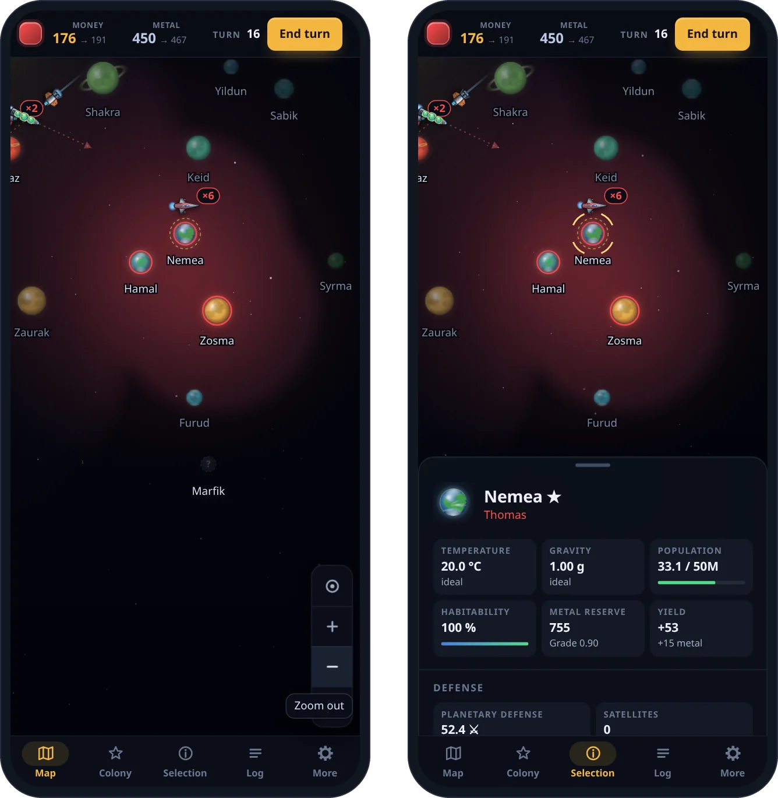

| Gesture | Classic | Space |
|---|---|---|
| Drag one finger | pan the map | rotate the camera |
| Spread / pinch two fingers | zoom | zoom |
| Drag two fingers | pan the map | pan the focus |
| Tap | select | select |

Setting a course needs no right click: tap the fleet, tap the target planet, use
*Fleet here* in the sheet.

A tablet in landscape keeps the floating windows; on any touch screen buttons,
tabs and grips grow to fingertip size.

## The look

The planets deliberately follow the style of the original: glossy, richly coloured
spheres where **colour shows temperature** (blue = icy to red = scorching) and
**size shows gravity**. The more habitable a planet becomes, the more Earth-like it
looks – oceans, continents with ragged coastlines, clouds and polar caps. So
terraforming is visible right on the map.

Settled planets tint their surroundings in the colour of their colony; neighbouring
planets merge into one area, so a glance tells you who owns which corner. The ships
are drawn by hand – each class with its own silhouette, engine glow, panel lines,
navigation lights and player colour; the colony ship is recognisable by its three
habitat domes.
