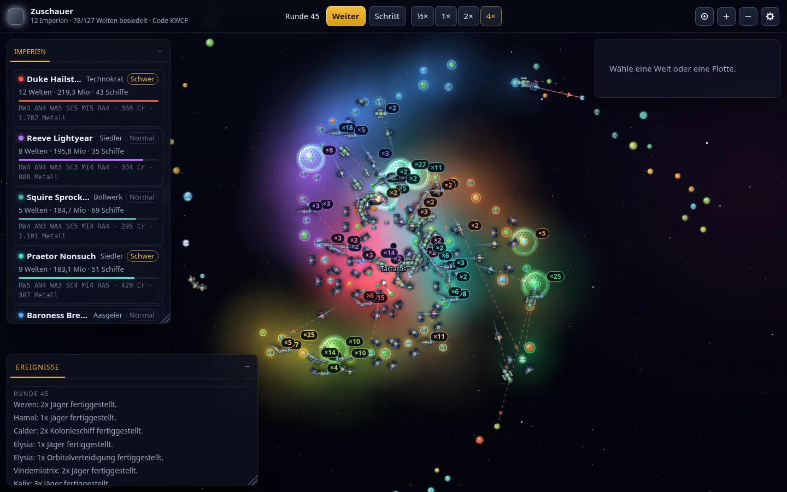

# Ho!!

*[English](readme.md) · **Deutsch***

[](https://github.com/db0x/Ho/actions/workflows/ci.yml)
[](LICENSE)
[](package.json)

Ein Weltraum-Strategiespiel im Geist von **Spaceward Ho!** – im Browser, für bis zu
16 Spieler gleichzeitig.



*Die flache Sternkarte, beim Zusehen: zwölf KI-Reiche in Runde 45. Besiedelte
Welten färben ihre Umgebung in der Farbe ihres Reiches.*

Die Planeten sind bewusst im Stil des Originals gehalten: glänzende, satt gefärbte
Kugeln, bei denen die **Farbe die Temperatur** (blau = eisig bis rot = glühend) und
die **Größe die Schwerkraft** anzeigt. Je bewohnbarer eine Welt wird, desto
erdähnlicher sieht sie aus: Über die Kugel legen sich **Ozeane**, dazu kommen
**Kontinente mit zerklüfteten Küsten, Inseln, Wolkenschlieren und Polkappen**. Die
Temperaturfarbe wandert dabei auf die Kontinente – eine Eiswelt bleibt also
unterscheidbar, weil ihr Blau kahl ist. Terraforming sieht man so direkt auf der
Karte: Aus der fahlen Murmel wird Schritt für Schritt eine blaue Welt. Der Sternenhimmel liegt in drei Ebenen – viele kleine Punkte weit hinten, wenige
große vorn –, die unterschiedlich schnell vorbeiziehen; in der räumlichen Ansicht
dreht er sich entsprechend langsam mit. Besiedelte Welten färben ihre Umgebung dezent
in der Farbe ihres Reiches – benachbarte Welten verschmelzen dabei zu einer Fläche,
sodass man auf einen Blick sieht, wem welche Ecke der Galaxie gehört. Die Schiffe sind neu gezeichnet – jede Klasse
hat eine eigene Silhouette mit Triebwerksglühen, Panelstruktur und Spielerfarbe.

```
npm install
npm run users -- add captain   # Zugang anlegen, Passwort wird ausgegeben
npm start                      # http://localhost:8080
```

Vor der Lobby steht eine Anmeldung – siehe *[Zugang](#zugang)*. Zum Entwickeln
nimmt `HO_AUTH=off npm start` sie weg.

KI-Reiche treten unter eigenem Namen an – von *Admiral Wobblebeard* bis
*Czarina Candyfloss* – und jedes mit eigenem Charakter: Der **Eroberer** sucht
sich einen Rivalen und rollt ihn Welt für Welt auf, der **Siedler** breitet sich
aus und schlägt nur zurück, der **Technokrat** kommt spät mit besserer Technik,
der **Pirat** schickt schnelle Rudel gegen schwache Kolonien, das **Bollwerk**
mauert sich mit Satelliten ein, bis es ausbricht, und der **Aasgeier** holt
sich, was die anderen übrig lassen. Sie merken sich, wer sie angegriffen hat,
verbünden sich stillschweigend gegen einen davonziehenden Spitzenreiter und
werden ungeduldig, je länger die Partie dauert – das Spätspiel erstarrt so
nicht zu zwölf Festungen.

Für eine schnelle Partie: *Sofort gegen 5 KI spielen*. Für eine Runde mit Freunden
*Neue Partie eröffnen*, den vierstelligen Code weitergeben, freie Plätze mit KI
füllen und starten. Im LAN erreichen die anderen den Server unter
`http://<deine-ip>:8080`. Wer lieber zuschaut: *Beim Spielen zusehen* startet eine
reine KI-Partie, die von allein läuft.


*Die Lobby: oben der vierstellige Code, freie Plätze mit KI besetzt, rechts
Spielfeld und Regeln.*

Das **Logo** ist handgezeichnetes SVG und folgt derselben Bildsprache: Messing
für die Schrift und eine erdähnliche Welt als *o* – mit zerklüfteten Küsten,
Hochland, Wüste, Binnenseen, Inselketten, Wolken, Polkappen und einer Nachtseite.
Es braucht keine Schriftart (alles sind Pfade) und skaliert vom Startbildschirm
bis zum 16-Punkte-Tabsymbol (`client/img/logo.svg` und `client/img/mark.svg`).

## Spielprinzip

Alle Spieler ziehen **gleichzeitig**. Jeder erteilt seine Befehle und klickt
*Zug beenden*; sobald alle fertig sind (oder die Zugzeit abläuft), rechnet der
Server die Runde ab – Forschung, Bau, Terraforming, Bewegung, Kampf, Wirtschaft.

| Begriff | Bedeutung |
|---|---|
| **Ideal** | 20 °C und 1,0 g. Je näher eine Welt daran liegt, desto mehr Menschen leben dort und desto mehr Geld bringt sie. |
| **Terraforming** | Kostet Geld und schiebt Temperatur und Schwerkraft Richtung Ideal. Extreme Welten brauchen erst höhere **Radikaltechnik**. |
| **Metall** | Wird auf den eigenen Welten abgebaut, in einen globalen Vorrat gelegt und beim Schiffsbau verbraucht. Die Vorräte eines Planeten erschöpfen sich. |
| **Reichweite** | Abstand vom nächsten *bewohnten eigenen* Planeten. Neue Kolonien sind damit auch Sprungbretter; Tanker erweitern den Radius. |
| **Technikstand** | Schiffe werden mit dem Stand ihres Baujahrs gebaut und behalten ihn. Höhere Stufen machen Schiffe besser *und teurer* – **Miniaturisierung** senkt die Kosten wieder. |
| **Abwehrbatterien** | Jede bewohnte Welt verteidigt sich selbst, proportional zur Bevölkerung. Eine ausgebaute Welt kostet den Angreifer eine echte Flotte. |
| **Orbitalverteidigung** | Billige, unbewegliche Verteidiger, die dauerhaft im Orbit bleiben. |
| **Ausdehnung** | Die Galaxie hat keinen festen Rand. Wer nach außen vorstößt, findet dahinter neue Welten – rauer, aber erzreicher. In der Spirale wachsen stattdessen die Arme weiter hinaus. |

**Das Budget ist knapper, als der Kontostand sagt.** Abgerechnet wird in dieser
Reihenfolge: erst die Forschung, dann der Schiffsbau – die Einnahmen kommen zum
Schluss. Fürs Bauen steht also *Geld minus Forschungsanteil* bereit, und zwar für
alle Werften zusammen. Dazu kommt: Ein Durchbruch in derselben Runde macht die
Schiffe teurer, weil sie mit dem neuen Stand gebaut werden. Die Oberfläche rechnet
das vor dem Zugende nach – in der Topbar steht hinter Geld und Metall, was schon
verplant ist (rot, wenn es nicht reicht), die Werft nennt den Fehlbetrag, und beim
Klick auf *Zug beenden* kommt notfalls noch ein Hinweis.

Eine Welt fällt, wenn ein Angreifer den Orbit hält und weder Orbitalverteidigung noch
Abwehrbatterie überlebt haben. Die Bevölkerung geht dabei zurück, der Rest wechselt
den Besitzer.

### Form der Galaxie: Streufeld oder Spirale

Unabhängig vom Spielfeld lässt sich die **Form** wählen. *Streufeld* verteilt die
Welten gleichmäßig – das bisherige Verhalten. *Spirale* baut eine Galaxie, wie man
sie sich vorstellt: zwei oder drei logarithmische Arme um einen dichten Kernwulst,
und in der Mitte ein **schwarzes Loch** (es trägt einen Namen wie *Charybdis*
oder *Nyx*): ein weich auslaufender Schlund mit Photonenbogen, um den sich
Materie in sieben Armen nach innen dreht. In der räumlichen Ansicht liegen diese
Arme in der Galaxienebene, die hintere Hälfte verschwindet also hinter dem
Schlund.

Das Loch ist kein Hintergrundbild, sondern Gelände: Um den Schlund liegt eine
**Sperrzone** (das 1,8-fache seines Radius, ein gestrichelter Ring auf der
Karte). Dort entsteht keine Welt, und keine Flotte fliegt hinein. Wer ein Ziel
dahinter anfliegt, wird **automatisch aussen herum geführt** – zwei Tangenten
und ein Bogen entlang der Grenze, gerechnet in der Ebene durch Start, Ziel und
Loch, also flach wie räumlich gleich. Der Weg wird dadurch länger und kostet
Runden; dasselbe gilt für den Nachschub, denn die **Reichweite** misst ab sofort
den fliegbaren Weg und nicht die Luftlinie. Welten hinter dem Loch rücken damit
spielerisch weiter weg, als sie aussehen. Die KI rechnet genauso und zieht
Ziele vor, die sie wirklich schnell erreicht (`shared/rules.js`: `holeZone`,
`route`, `travelDistance`; geprüft von `test/blackhole.js`).

Die Oberfläche rechnet dabei mit **denselben Funktionen** wie der Server. Der
Reichweiten-Umriss ist deshalb kein Kreis mehr, sondern hat zum Loch hin eine
**Delle** (`reachOutline`) – ein Kreis hätte Welten als erreichbar gezeigt, die
der Server gleich wieder abgelehnt hätte. Und liegt eine Welt außer Reichweite,
ist *Flotte hierher* von vornherein gesperrt und nennt den Grund, statt den
Befehl erst nach dem Klick zurückzuweisen.

Eine Spirale wächst anders: nicht in Streifen am Kartenrand, sondern **nach außen**.
Stößt jemand bis an die Armspitzen vor, reichen die Arme weiter und im neuen Ring
entstehen Welten – entlang der Arme, nicht gleichmäßig verteilt. Gemessen am
fertigen Spielstand liegen über 95 % der Welten außerhalb des Kerns tatsächlich in
einem Arm.

Beide Formen gibt es flach und räumlich; die räumliche Spirale ist eine Linse mit
Armen, die flache sieht aus wie eine Galaxie von oben.

### Zwei Spielfelder: Klassik und Raum

Im Startbildschirm und in der Lobby lässt sich das **Spielfeld** wählen. *Klassik*
ist die flache Sternkarte wie bisher und bleibt unverändert. *Raum* verteilt
dieselbe Partie auf drei Dimensionen: die Welten liegen in einer **Linse**, in der
Fläche weit, in der Höhe etwa 40 % davon – mittig dicker, zum Rand hin dünner, wie
eine echte Galaxie. Entfernungen, Reichweite und Scanner rechnen dann räumlich.


*Die Raumansicht: das Gitter liegt in der Mittelebene der Galaxie, von jeder Welt
führt ein Lot darauf hinab – daran liest man ihre Höhe ab.*

| Aktion | Eingabe |
|---|---|
| Kamera drehen | Ziehen |
| Blickpunkt verschieben | **Shift**+Ziehen (oder mittlere Taste) |
| Zoomen | Mausrad, `+` / `−` |
| Draufsicht (wie Klassik) | `T` |
| Ganze Galaxie einpassen | `F` |
| Auswählen / Kurs setzen | Linksklick / Rechtsklick – wie in Klassik |

Damit Raum nicht zur Rätselei wird, gibt es drei Lesehilfen: ein **Gitter** in der
Mittelebene der Galaxie, ein **Lot** von jeder Welt auf dieses Gitter (daran sieht
man ihre Höhe) und eine Abstufung von Größe und Helligkeit nach Entfernung –
abgedunkelt wird dabei nur, was hinter dem Blickpunkt liegt; davor bleibt alles
deckend, sonst schaut das Gitter durch die Welten.
Gezeichnet wird von Hand auf dasselbe Canvas – keine 3D-Bibliothek, kein
Build-Schritt; die Welten bleiben dieselben Sprites und wenden sich der Kamera zu.

### Wie die KI kämpft

Die KI greift eine Welt nur an, wenn ihre Flotte die Abwehr in **einem Zug**
brechen kann – die Abwehrbatterie wird jede Runde aus der Bevölkerung neu
aufgebaut, Belagern bringt also nichts. Sie schätzt dafür vor, was eine Welt
kostet (Batterie, Orbitalverteidigung, Flotten im Orbit), und sammelt sonst weiter.

Fällt ein Reich auf drei bekannte Welten zurück, wird es zum **Kriegsziel**:
Statt weiter an Randkolonien zu knabbern, ziehen die Flotten an der nächsten
eigenen Welt zusammen und schlagen erst zu, wenn es für den Gnadenstoß reicht –
auch gegen eine Heimatwelt. Gemessen über drei Partien à 300 Runden mit 16 KI
überleben dadurch noch 10 bis 13 Reiche; vorher schied nie eines aus.

### Zusehen

*Beim Spielen zusehen* im Startbildschirm setzt eine Partie mit 4 bis 16 KI-Reichen
auf und startet sie sofort. Es gibt kein eigenes Reich – dafür liegt alles offen:
jede Welt, jede Flotte samt Zusammensetzung, das vollständige Ereignisprotokoll
und eine Tabelle aller Reiche mit Technikständen, Kasse und Erzvorrat.

Den Takt gibt der Server vor, weil hier niemand *Zug beenden* drückt: oben rechts
sitzen **Pause**, **Schritt** (eine Runde weiter, wenn pausiert) und die
Geschwindigkeiten ½× bis 4× – 1× ist eine Runde alle 1,5 Sekunden. Die Leertaste
hält an und lässt weiterlaufen.

Mit *Verlassen* oben rechts kommt man jederzeit zum Startbildschirm zurück.

Der Partiecode steht oben links. Gibt man ihn im Startbildschirm unter *Beitreten*
ein, sieht man derselben Partie zu – der Takt gilt dann für alle Zuschauer
gemeinsam. Verlässt der letzte Zuschauer die Partie, wird sie aufgeräumt.

Zusehen geht nur bei reinen KI-Partien. In einer Partie mit menschlichen Spielern
gäbe es sonst einen Zuschauer, der alle Karten sieht.

### Eine Galaxie ohne Rand

Die Sternkarte ist nicht fertig, wenn die Partie beginnt. Kommt eine Flotte oder
eine besiedelte Welt der Grenze näher als 200 Lj, schiebt sich die Karte dort
hinaus und ein neuer Streifen Welten entsteht – höchstens einer pro Runde, in
der dringendsten Richtung. Die neuen Welten halten Abstand zum neuen Rand: um
den nächsten Streifen auszulösen, muss wirklich jemand weiterfliegen. Stehen
alle still, wächst nichts.

Je weiter eine Welt vom Startgebiet entfernt liegt, desto unwirtlicher ist sie –
extremere Temperaturen, extremere Schwerkraft, seltener Volltreffer. Dafür liegt
dort mehr Erz, und zwar in besserer Güte. Draußen zu siedeln lohnt sich also,
kostet aber Terraforming und **Radikaltechnik**.

In einer Partie mit 16 KI wächst die Karte dadurch von 96 auf rund 390 Welten in
120 Runden und auf etwa 1.000 bis zum Rundenlimit – mit Pausen, wenn die Reiche
gerade nur konsolidieren. Abschalten lässt sich das in der Lobby.

### Auf dem Telefon

Ho!! läuft auch auf einem Telefon – geprüft auf einem schmalen 21:9-Gerät
(412 × 960 CSS-Punkte, hoch und quer). Ist das Fenster **schmaler als 760** oder
**niedriger als 560 Punkte**, baut sich die Oberfläche um:

- Statt der drei schwebenden Docks gibt es eine **Leiste am unteren Rand**
  (Karte · Reich · Auswahl · Protokoll · Mehr). Immer nur ein **Blatt** ist
  offen, die Karte behält den Rest.
- **Hochkant** liegt das Blatt unten, **quer** an der rechten Seite – quer ist
  nach unten kein Platz, nach rechts schon.
- Eine Welt antippen schlägt ihr Blatt auf, und die Welt rückt in den Teil der
  Karte, den das Blatt frei lässt. Auf leeren Raum tippen klappt es wieder zu.
- Die Topbar wird einzeilig: Wappen, Geld, Metall, Runde, *Zug beenden*.
  *Partie verlassen* steht unter *Mehr*, zusammen mit Anzeige und Ton.
- Schalter, Regler und die `+`/`−`-Knöpfe der Werft sind auf Daumengröße
  gebracht; die Leiste hält Abstand zur Systemleiste (`safe-area-inset`).

Gesten auf der Karte:

| Geste | Klassik | Raum |
|---|---|---|
| Ein Finger ziehen | Karte schieben | Kamera drehen |
| Zwei Finger spreizen / zusammenziehen | zoomen | zoomen |
| Zwei Finger schieben | Karte schieben | Blickpunkt verschieben |
| Tippen | auswählen | auswählen |

Einen Kurs setzt man ohne Rechtsklick: Flotte antippen, dann die Zielwelt
antippen und im Blatt *Flotte hierher*. Die Karte fängt Wisch- und Zoomgesten
selbst ab (`touch-action: none`), damit beim Schwenken nicht die Seite mitgeht.

### Steuerung

| Aktion | Eingabe |
|---|---|
| Karte bewegen / zoomen | Ziehen, Mausrad, `+` / `−` |
| Auswählen | Linksklick auf Welt oder Flotte |
| Kurs setzen | Flotte wählen, dann **Rechtsklick** (oder Shift-Klick) auf die Zielwelt – oder die Zielwelt anklicken und im Panel *Flotte hierher*. Geht zu jeder Welt, auch zu den eigenen (Verteidigung, Sprungbrett für die Reichweite). |
| Zug beenden | Knopf oben rechts oder `Leertaste` |
| Karte einpassen | `F` |
| Auswahl aufheben | `Esc` |
| Hilfe | `H` |
| Partie verlassen | Knopf *Verlassen* oben rechts |
| Protokoll verschieben / vergrößern | An der Titelleiste ziehen bzw. am Griff unten rechts; Doppelklick auf die Leiste klappt es ein |
| Draufsicht (nur Raum-Modus) | `T` |
| Zusehen: anhalten / weiterlaufen | `Leertaste` |
| Anzeige und Ton (Namen, Reichweite, Gebiete, Sterne, Lautstärke) | Zahnrad unten rechts; klappt die Schalter auf, `Esc` oder ein Klick daneben schließt sie wieder |
| Auf dem Telefon | Leiste unten statt Docks, Gesten auf der Karte – siehe *Auf dem Telefon* |

## Aufbau

Kein Build-Schritt, keine Framework-Abhängigkeiten – nur `ws` auf dem Server.
Client und Server teilen sich dieselbe Regeldatei.

```
shared/rules.js      Spielregeln, Kosten- und Kampfformeln (Server + Browser)
shared/i18n.js       Übersetzungskern (Browser + Node)
server/
  index.js           HTTP (statische Dateien) + WebSocket, Lobby, Partieverwaltung, Zuschauertakt
  auth.js            Zugang: Sitzungen, Anmeldung, Passwortwechsel, Torwächter für HTTP und WebSocket
  userstore.js       Konten auf der Platte: Name und scrypt-Hash, atomar geschrieben
  users.js           Werkzeug für den Host (docker exec): add, del, passwd, name, list
  game.js            Spielzustand, Zugauflösung, Sichten (Spieler und Zuschauer)
  galaxy.js          Sternkarte: Streufeld oder Spirale, Ausdehnung (deterministisch über einen Seed)
  bot.js             KI-Gegner; spielt nach denselben Regeln und mit eigener Aufklärung,
                     schätzt vor dem Angriff die Abwehr und gibt Angeschlagenen den Rest
client/
  index.html         Startbildschirm, Lobby, Spielbildschirm
  login.html         Anmeldung und erster Passwortwechsel - alles, was ohne Sitzung herauskommt
  img/logo.svg       Wortmarke (H, Welt als o, zwei Ausrufezeichen)
  img/mark.svg       dasselbe Zeichen allein - Tab-Symbol und Startbild
  js/main.js         Verdrahtung, Spielschleife
  js/login.js        Anmeldeseite: Formulare, Sprachwahl, Weiterleitung ins Spiel
  js/net.js          WebSocket mit automatischem Wiederverbinden
  js/render/         planets.js (Planetenstil), ships.js (Schiffe),
                     map.js (flache Sternkarte), space.js (räumliche Sternkarte)
  js/ui/             lobby.js, hud.js (alle Panels), select.js (eigene Auswahllisten),
                     dialog.js (verschiebbare Fenster, z. B. das Protokoll),
                     viewport.js (ein Umschaltpunkt für kleine Geräte)
  js/i18n.js         Sprache erkennen, merken, Markup füllen
  i18n/de.js, en.js  Textkataloge
  js/audio/sfx.js    Klangeffekte, zur Laufzeit synthetisiert
test/
  smoke.js           Spielt eine volle Partie mit 16 KI durch und prüft die Invarianten
  blackhole.js       Spiralpartie: keine Flotte in der Sperrzone, Kurse gehen aussen herum
  i18n.js            Kataloge: gleiche Schlüssel, gleiche Platzhalter, Serverschlüssel
  multiplayer.js     Startet den echten Server und lässt 16 WebSocket-Clients spielen
  auth.js            Zugang: Hashes, Konten, Torwächter, Rateschutz, Pfadtricks
```

**Zeichnen kostet, also wird gespart.** Ein rundenbasiertes Spiel muss die
Sternkarte nicht 60-mal pro Sekunde neu rastern. Im Leerlauf zeichnet die Karte
mit 20 Bildern pro Sekunde (`IDLE_FPS` in `client/js/main.js`); bei Eingabe,
Kamerabewegung und neuer Sicht sofort wieder mit voller Rate. Hintergrundverlauf,
Nebel und Gebietsfarben liegen in einem Zwischencanvas und werden nur neu gebaut,
wenn sich die Kamera bewegt; darüber kommen die ziehenden Sterne. Ein versteckter Tab zeichnet gar nicht, und der Audiokontext hält
sich nach 20 Sekunden Stille selbst an.

**Der Server rechnet, der Client zeigt an.** Jeder Spieler bekommt eine eigene,
gefilterte Sicht: unerforschte Welten sind nur Positionen, einmal besuchte Welten
zeigen den letzten bekannten Stand (abgedunkelt dargestellt), und von fremden
Flotten ist nur die Schiffszahl sichtbar – nie deren Technikstand oder Hülle.

**Aufklärung reicht bis zum Kurs.** Eine fremde Flotte wird geortet, wenn sie bei
einer sichtbaren Welt steht, näher als 300 Lj an einer eigenen Welt oder näher als
240 Lj an einer eigenen Flotte. Wer sie so im eigenen Raum hat, sieht ab dann auch,
**wohin** sie fliegt und **in wie vielen Runden** sie dort ist – als Kurslinie auf
der Karte und im Panel. Womit sie fliegt, bleibt verdeckt: Zusammensetzung,
Technikstand und Hülle sendet der Server weiterhin nicht.

## Ton

Die Effekte werden im Browser **synthetisiert** – es gibt keine Audiodateien und
keine zusätzliche Abhängigkeit. Jeder Klang entsteht aus Oszillatoren und
gefiltertem Rauschen (`client/js/audio/sfx.js`); die Rezepttabelle dort legt
Tonhöhen, Hüllkurven und Filter fest.

Zu hören sind Klicks und Auswahl, gesetzte Kurse, der Rundengong und die
Ereignisse der abgerechneten Runde: Raumschlacht, Invasion, Kolonie,
Schiffsbau, Forschungsstufe, Terraforming, Ankunft, Warnungen, Verlust einer
Welt, Ausscheiden und Sieg. Ereignisse mit Planetenbezug klingen **dort, wo die
Welt auf dem Bildschirm liegt** – eine Schlacht am linken Kartenrand kommt von
links.

Pro Runde können viele Dinge gleichzeitig passieren. Damit das kein Lärm wird,
werden gleiche Effekte gestaffelt und begrenzt, die Ereignisse nach Wichtigkeit
sortiert (Sieg und Verlust vor Ankunft und Warnung) und nacheinander
eingespielt; ein Begrenzer hält die Summe im Rahmen.

Schalter und Lautstärke sitzen unten rechts hinter dem Zahnrad, die
Einstellung bleibt im Browser gespeichert. Browser lassen Ton erst nach der
ersten Nutzeraktion zu – der erste Klick weckt die Ausgabe. Nach 20 Sekunden
ohne Klang hält sich der Audiokontext an (er kostet sonst dauerhaft Rechenzeit)
und wacht beim nächsten Klang von selbst wieder auf.

## Sprachen

Die Oberfläche spricht **Deutsch und Englisch**. Beim ersten Start entscheidet die
Sprache des Browsers, danach die Wahl unten im Startbildschirm; sie wird im Browser
gemerkt. Umschalten geht **mitten in der Partie** – ohne Neuladen.

Im Code steht kein Satz, den ein Mensch liest. Er kennt nur Schlüssel
(`log.arrive`, `yard.notEnough`), die Sätze stehen in den Katalogen:

```
shared/i18n.js       Kern: t(), Platzhalter {name}, Mehrzahl (#one/#other), Zahlen
client/js/i18n.js    Sprache erkennen und merken, Markup mit data-i18n füllen
client/i18n/de.js    deutscher Katalog
client/i18n/en.js    englischer Katalog
```

Auch der **Server** schickt keine fertigen Sätze mehr, sondern Schlüssel samt
Werten (`{ key: 'log.built', params: { planet: 'Sirrah', count: 3, ship: 'fighter' } }`).
Erst der Client setzt daraus einen Satz zusammen – deshalb sieht jeder Spieler
dasselbe Ereignis in **seiner** Sprache, auch in derselben Partie.

Eine weitere Sprache braucht eine Datei in `client/i18n/`, eine Zeile in
`client/js/i18n.js` und ggf. eine Mehrzahlregel in `shared/i18n.js`
(Deutsch und Englisch teilen sich dieselbe). `npm run test:i18n` prüft, dass die
Kataloge dieselben Schlüssel und dieselben Platzhalter haben und dass jeder
Schlüssel, den der Server schickt, auch übersetzt ist.

Im Markup werden Texte ausgezeichnet statt eingetragen:

```html
<button data-i18n="top.endTurn"></button>
<input data-i18n-attr="placeholder:chat.placeholder">
<p data-i18n-html="help.goal.p"></p>
```

## Zugang

Auf einem Server im Netz soll nicht jeder mitspielen, der die URL kennt. Vor der
Lobby steht darum eine Anmeldung mit Benutzername und Passwort. Ohne gültige
Sitzung gibt der Server weder den Spielclient noch die WebSocket heraus – und das
Spiel läuft über die WebSocket, eine Anmeldung nur vor der Seite wäre also keine.

Auf dem Host steht je Konto nur der **Name** und ein **scrypt-Hash** des Passworts,
gesalzen, mit den Parametern im Hash. Kein Klartext, keine Mailadresse, keine
Sitzungsschlüssel: die liegen allein im Serverspeicher und sind nach einem Neustart
weg – mit ihm sind ohnehin alle Partien weg.

### Konten anlegen und löschen

Konten entstehen und verschwinden auf dem Host, nicht im Browser:

```
docker exec ho node server/users.js add captain                # gewürfeltes Passwort
docker exec ho node server/users.js add captain geheim-genug   # oder ein eigenes
docker exec ho node server/users.js list                       # wer darf mitspielen
docker exec ho node server/users.js passwd captain             # Passwort zurücksetzen
docker exec ho node server/users.js name captain Captain       # Schreibweise der Anzeige (nur Groß/Klein)
docker exec ho node server/users.js del captain                # Konto löschen
```

`add` gibt das erste Passwort **einmal** aus – das ist der einzige Moment, in dem
es im Klartext existiert. Es gilt nur für die erste Anmeldung: danach muss der
Spieler ein eigenes wählen, bevor er in die Lobby kommt. Nach `passwd` genauso.

`del` wirkt sofort, auch mitten in einer Partie: HTTP-Anfragen werden ab der
nächsten abgewiesen, eine offene WebSocket wird binnen einer Sekunde getrennt. Ein
zurückgesetztes Passwort beendet ebenso alle Sitzungen des Kontos.

Ohne Docker geht es genauso, nur kürzer:

```
npm run users -- add captain
```

Die Konten liegen in `data/users.json`, im Container in `/data/users.json` in
einem eigenen Volume – ein neues Abbild nimmt sie also nicht mit. Die Datei trägt
Rechte 0600 und wird erst daneben geschrieben und dann umgeschoben, damit ein
Abbruch nicht den ganzen Bestand verliert.

### Was die Anmeldung aushält

- **Rateversuche werden gebremst.** Ab dem fünften Fehlversuch wird gesperrt, und
  zwar immer länger (30 s, 1 min, 2 min … bis 15 min). Gezählt wird nach Konto
  *und* nach Herkunft: so lässt sich weder ein Konto durchprobieren noch von einer
  Stelle aus streuen.
- **Der Sitzungskeks** ist `HttpOnly` und `SameSite=Lax`, hinter HTTPS zusätzlich
  `Secure`. Die Endpunkte nehmen nur echtes JSON an – ein Formular von einer
  fremden Seite kommt damit nicht durch.
- **Ein unbekannter Name braucht genauso lange wie ein bekannter.** Die
  Antwortzeit verrät nicht, welche Konten es gibt.
- **Vor dem ersten Passwortwechsel** gibt es eine Sitzung, aber kein Spiel.
- **Ohne Sitzung** kommt nur die Anmeldeseite heraus, dazu Stylesheet, Wortmarke
  und die Sprachkataloge. Weder `client/js/`, noch `shared/rules.js`, noch ein
  Pfad mit kodierten Trennern (`/css/..%2f..%2f…`) führt daran vorbei.

### Hinter einem Reverse-Proxy

Der Server spricht HTTP und kennt kein TLS – das macht der Proxy davor. Zwei
Dinge braucht er unbedingt:

```nginx
location / {
    proxy_pass http://127.0.0.1:8080;
    proxy_http_version 1.1;
    proxy_set_header Upgrade $http_upgrade;      # sonst kommt keine WebSocket zustande
    proxy_set_header Connection "upgrade";
    proxy_set_header Host $host;
    proxy_set_header X-Forwarded-Proto $scheme;  # sonst fehlt dem Keks das Secure-Flag
    proxy_set_header X-Forwarded-For $remote_addr;
}
```

Und der Port gehört dann nur an den Proxy, nicht ans offene Netz:

```
HOST_BIND=127.0.0.1 docker compose up -d
```

### Einstellungen und Abschalten

Zum Entwickeln ist die Anmeldung im Weg. `HO_AUTH=off` nimmt sie weg; der Server
sagt beim Start auch deutlich, dass er offen steht. Auf einem Server, der aus dem
Netz erreichbar ist, hat das nichts zu suchen.

| Variable | Standard | Bedeutung |
| --- | --- | --- |
| `HO_AUTH` | an | `off` schaltet die Anmeldung ab |
| `HO_USERS_FILE` | `data/users.json` | wo die Konten liegen |
| `HO_SESSION_DAYS` | `30` | wie lange eine Sitzung gilt |
| `HO_SECURE_COOKIES` | automatisch | `1`/`0` erzwingt oder verbietet das `Secure`-Flag |
| `HO_LANG` | aus der Umgebung | Sprache des Werkzeugs auf dem Host |

## Tests

```
npm test             # alle Testläufe
npm run test:i18n    # Kataloge: gleiche Schlüssel, gleiche Platzhalter, Serverschlüssel
npm run test:engine  # 120 Runden mit 16 KI, prüft Bilanz- und Zustandsinvarianten
npm run test:hole    # Spiralpartie: Sperrzone um das schwarze Loch hält
npm run test:net     # Lobby, 16 Clients, Simultanzug-Logik, Trennung, Chat
npm run test:auth    # Zugang: Hashes, Konten, Anmeldung, Passwortwechsel, Rateschutz
```

## Docker

Alternativ ohne lokales Node:

```
docker compose up -d --build       # http://localhost:8080
docker compose logs -f             # Serverausgabe
docker compose down                # stoppen
```

Der Host-Port lässt sich über `HOST_PORT` verschieben (`HOST_PORT=3000 docker compose up -d`),
im Container hört der Server weiterhin auf 8080. Die Tests laufen im selben Image:

```
docker compose --profile test run --rm test
```

Die Anmeldung ist im Container an. Lokal, wo nur du spielst, schaltest du sie mit
einer `.env` neben der `docker-compose.yml` ab (Vorlage: `.env.example`):

```
HO_AUTH=off
```

Auf dem Server gehört diese Zeile nicht hin – ohne sie bleibt die Anmeldung an.
Einmalig geht es auch ohne Datei: `HO_AUTH=off docker compose up -d`. Ob sie läuft,
sagt das Protokoll beim Start (`docker compose logs ho | grep Zugang`).

Die Konten liegen im Volume `ho-data` und überleben jedes neue Abbild; angelegt
werden sie mit `docker exec` (siehe *[Zugang](#zugang)*). Laufende Partien liegen
nur im Serverspeicher – ein Neustart des Containers beendet sie, und mit ihnen die
offenen Sitzungen.

## Einstellungen

In der Lobby einstellbar: Welten pro Spieler (3–14), Startkapital, Startmetall,
Zugzeit (0 = es wird gewartet, bis alle fertig sind) und ob die Galaxie mit der
Erkundung wächst (siehe *Eine Galaxie ohne Rand*; aus ergibt die alte, feste Karte). Der Port lässt sich über die
Umgebungsvariable `PORT` setzen:

```
PORT=3000 npm start
```

Ein getrennter Spieler blockiert die Runde nicht – er wird übersprungen und kann
jederzeit zurückkehren (der Platz wird im Browser gespeichert). Wer über *Verlassen*
aussteigt, gibt den Platz endgültig auf: Das Reich bleibt stehen und wird
übersprungen, die Partie läuft für die anderen weiter. War es der letzte Mensch,
wird die Partie aufgeräumt. Partien ohne
verbundene Spieler werden nach zwei Stunden aufgeräumt.

## Was noch fehlt

- Diplomatie und Bündnisse
- Dauerhafte Speicherung laufender Partien (derzeit nur im Serverspeicher)
- Hintergrundklang (bisher nur Effekte, keine Atmosphäre und keine Musik)
- Eine in die Enge getriebene KI igelt sich nur ein: sie häuft Schiffe auf ihrer
  letzten Welt an, statt auszubrechen

## Lizenz

Der Code steht unter der **MIT-Lizenz** – benutzen, ändern, weitergeben, auch
Kommerzielles daraus bauen; Urheberrechtsvermerk und Lizenztext bleiben dabei
erhalten. Der genaue Wortlaut steht in [LICENSE](LICENSE). Getrennte
Asset-Lizenzen sind nicht zu beachten, denn es gibt keine Assets im üblichen Sinn:
Die Grafiken sind handgeschriebenes SVG und Canvas-Zeichenbefehle, die Klänge
entstehen beim Abspielen im Browser, und die einzige Abhängigkeit ist `ws`
(ebenfalls MIT). Bis auf die Bildschirmfotos unter `doc/screenshots/` ist alles in
diesem Verzeichnis Quelltext; die Aufnahmen zeigen das Spiel selbst und stehen unter
derselben Lizenz.

**Ho!!** ist eine eigenständige Neuimplementierung und steht in keiner Verbindung
zu Delta Tao Software, ist von dort weder unterstützt noch lizenziert.
*Spaceward Ho!* ist deren Marke, und das Originalspiel bleibt deren Werk – dieses
Projekt übernimmt die Idee und das Spielgefühl, nicht den Code, nicht die Grafiken
und nicht die Texte. Die Planetenoptik folgt dem Original im Geist; gezeichnet
wurde hier jede Linie neu.
