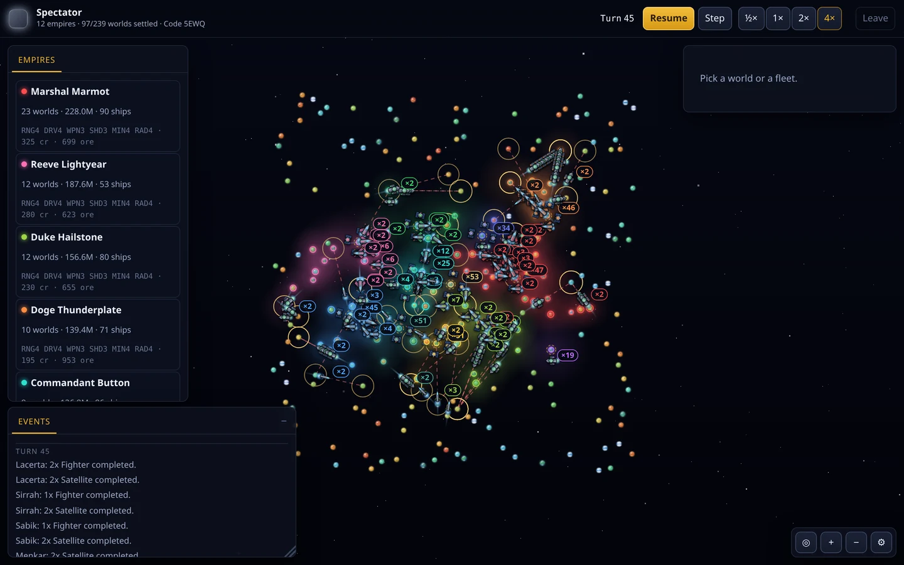
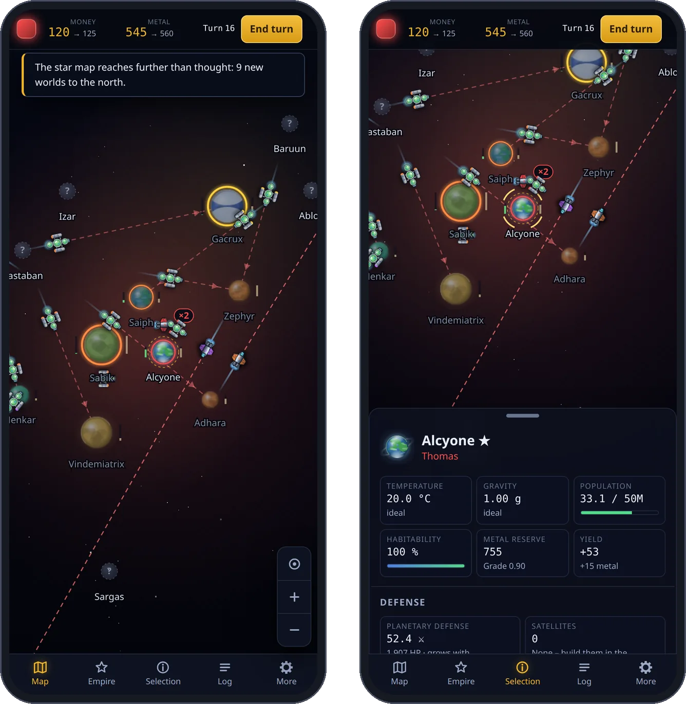

# Ho!!

***English** · [Deutsch](readme.de.md)*

[](https://github.com/db0x/Ho/actions/workflows/ci.yml)
[](LICENSE)
[](package.json)

A space strategy game in the spirit of **Spaceward Ho!** – in the browser, for up to
16 players at once.



*Twelve AI empires at turn 45. Colour shows a world's temperature, size its
gravity; settled worlds tint their surroundings in their empire's colour.*

- **Simultaneous turns** for up to 16 players – friends via a four-letter code,
  empty seats filled with AI.
- **AI with personality:** conqueror, settler, technocrat, raider, bulwark, vulture.
- **Flat or in space,** as a scatter field or a spiral galaxy with a black hole –
  and a map that grows as you explore.
- **A budget that adds up:** the top bar shows where your money goes before you end
  the turn.
- **No build step, no assets:** graphics are drawn in code, sounds synthesised in
  the browser; the only dependency is `ws`.
- **On the go too:** on phones and tablets with an interface of its own – a bar
  along the bottom, sheets instead of windows, gestures for map and space.

<p align="center"></p>

## Quick start

```
npm install
npm run users -- add captain   # create access, the password is printed
npm start                      # http://localhost:8080
```

Or with Docker: `mkdir -p data && docker compose up -d --build`.
For local play without sign-in: `HO_AUTH=off npm start`.

Then *Play 5 AI right away*, or *Host a new game* and pass on the code.

## Documentation

| | |
|---|---|
| **[Playing](doc/playing.md)** | Rules, money and budget, combat, galaxy shapes, AI, watching, controls, phone |
| **[Hosting](doc/hosting.md)** | Node and Docker, accounts, security, reverse proxy, settings, data |
| **[Development](doc/development.md)** | Structure, principles, languages, sound, graphics, tests, roadmap |

## License

MIT – see [LICENSE](LICENSE). Everything in this repository is source code, apart
from the screenshots under `doc/screenshots/`, which fall under the same licence.

**Ho!!** is an independent reimplementation and not connected with, endorsed by or
licensed from Delta Tao Software. *Spaceward Ho!* is their trademark; this project
borrows the idea and the feel, not the code, graphics or texts.
